# AI Job Agent

A personal AI agent that finds relevant jobs in India and the Middle East, analyses your CV,
prepares tailored applications, fills forms on supported sites, tracks every application, and
keeps working overnight. It asks for your approval before anything irreversible.

> **Current status:** the agent **finds jobs that match your CV, ranks them, and explains each
> match with quotes from your CV.** It does **not apply for you yet**: you open the job link and
> apply yourself. Applying, cover letters, emails and daily automatic runs are later phases (see
> the [roadmap](docs/development/implementation-roadmap.md)).

## What it can do today

| Feature                 | What happens                                                                                                                                       | Speed                                    |
| ----------------------- | -------------------------------------------------------------------------------------------------------------------------------------------------- | ---------------------------------------- |
| **CVs**                 | Upload a PDF or Word CV. Text is extracted in the background; contact details are suggested (you confirm them). Stored encrypted.                  | Seconds                                  |
| **Profile and Answers** | Your details and verified answers (notice period, salary…) for reuse later. Nothing is invented.                                                   | Instant                                  |
| **Find jobs for me**    | Suggests roles and countries from your CV, searches job sources, keeps jobs in your countries that fit your roles, and saves the best 25 new ones. | ~30 seconds                              |
| **Skills check**        | For every job: which of its skills are in your CV and which are missing. No AI.                                                                    | Instant                                  |
| **Match analysis**      | AI compares the job with your CV and profile, scores it, and quotes the evidence for each point.                                                   | ~8–10 min on a laptop (free local model) |
| **Agent chat**          | Ask about your jobs and CV in plain language; the agent uses the same tools.                                                                       | ~10 min per reply locally                |
| **Activity**            | Every background task (search, analysis, CV processing) with its steps, retries and errors. Tasks survive restarts.                                | Live                                     |

Job sources: company career pages on Greenhouse, Lever and Ashby (free), Remotive for remote jobs
(free), and **JSearch** with your own key (adds Google Jobs listings from LinkedIn, Indeed, Naukri
and Naukri Gulf). The agent only _reads_ listings: it never signs in to job sites, scrapes them,
or submits anything.

## Setup, step by step (Windows, macOS or Linux)

You need about 30 minutes and 6 GB of free disk space the first time. Every later start is
step 9 only.

### What each piece is for

| Piece                      | What it does for the agent                                                                                                        | Free?                          |
| -------------------------- | --------------------------------------------------------------------------------------------------------------------------------- | ------------------------------ |
| **Node.js + pnpm**         | Run the web app and the background worker                                                                                         | Yes                            |
| **Docker Desktop**         | Runs **PostgreSQL** (stores your account, CVs, jobs, results) and **Redis** (the queue the worker takes tasks from) in containers | Yes                            |
| **Ollama**                 | Runs the AI model **on your own computer**, so your CV never leaves it                                                            | Yes                            |
| **JSearch key** (optional) | Adds India and Gulf listings from LinkedIn, Indeed, Naukri, Naukri Gulf                                                           | Free plan, ~200 searches/month |

### 1. Install the tools

| Tool           | Version                                      | Get it                                                                  |
| -------------- | -------------------------------------------- | ----------------------------------------------------------------------- |
| Node.js        | 22.12+ (24 recommended, see `.node-version`) | <https://nodejs.org>                                                    |
| Git            | any recent                                   | <https://git-scm.com>                                                   |
| Docker Desktop | any recent                                   | <https://www.docker.com/products/docker-desktop>                        |
| Ollama         | 0.40+                                        | <https://ollama.com/download> (Windows: `winget install Ollama.Ollama`) |

Start **Docker Desktop** once after installing and wait until it says "Engine running".

### 2. Get the code and install dependencies

```bash
git clone https://github.com/Afaquejaya/ai-job-agent.git
cd ai-job-agent
corepack enable pnpm   # makes the pinned pnpm (10.34.7) available
pnpm install
```

Windows without admin rights: `corepack enable pnpm --install-directory "$(npm config get prefix)"`.

### 3. Create your `.env` file

```bash
cp .env.example .env
```

Open `.env` and fill in these values. Generate each secret with
`node -e "console.log(require('crypto').randomBytes(32).toString('base64'))"`:

| Variable              | Value                                                                         |
| --------------------- | ----------------------------------------------------------------------------- |
| `AUTH_SECRET`         | a generated secret                                                            |
| `DATA_ENCRYPTION_KEY` | a generated secret. **Back it up**: without it your stored CVs cannot be read |
| `AI_PROVIDER`         | `ollama` (free, on your computer)                                             |
| `JSEARCH_API_KEY`     | optional, see step 8                                                          |

Never commit `.env` or paste its values anywhere.

### 4. Start the database and queue (Docker)

```bash
pnpm db:up        # starts PostgreSQL 17 and Redis 7.4 in Docker
pnpm db:migrate   # creates the tables
```

Check that both containers are **healthy**:

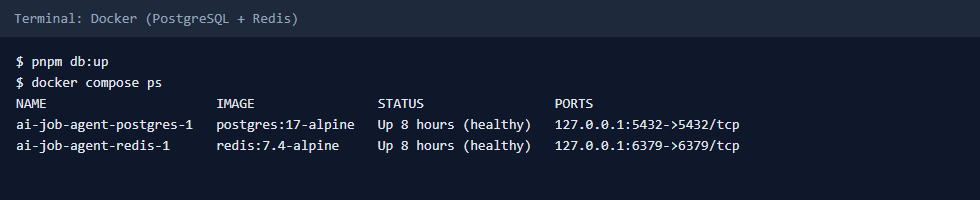

### 5. Download the free AI model (Ollama)

```bash
ollama pull qwen3:4b-instruct-2507-q4_K_M   # 2.5 GB, once
ollama list
```

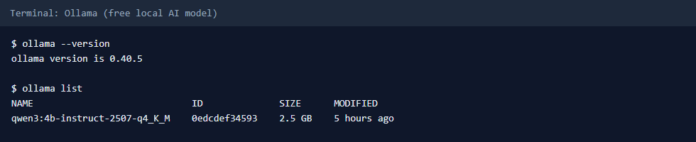

Ollama runs in the background (tray icon on Windows). Nothing is sent to the internet when the
model works. On a laptop, close heavy browser tabs before an analysis: the model needs ~3 GB of
free memory.

Prefer fast, paid AI? Set `AI_PROVIDER=anthropic`, `ANTHROPIC_API_KEY` (from the Anthropic
Console, with billing) and `AI_MONTHLY_BUDGET_USD` (e.g. `5`) instead.

### 6. Check everything (optional but recommended)

```bash
pnpm check              # format, lint, types, unit tests
pnpm test:integration   # database-backed tests
```

### 7. Run the app

```bash
pnpm dev
```

This starts **two programs**: the **web app** on <http://localhost:3000> and the **worker** (runs
searches, CV processing and AI analyses in the background). Keep this terminal open. Check:

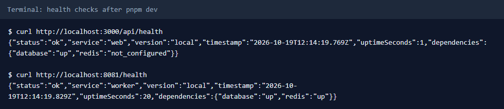

`database: up` on both, and `redis: up` on the worker, means everything is connected. If a task
stays "Queued" on the Activity page, the worker is not running or Redis/Docker is stopped.

### 8. (Optional) Add JSearch for LinkedIn, Indeed, Naukri and Naukri Gulf listings

1. Create a free account at <https://rapidapi.com> and subscribe to the **JSearch** API (free plan).
2. Copy your key into `.env` as `JSEARCH_API_KEY=...`.
3. Stop `pnpm dev` (Ctrl+C) and start it again.

Without a key, the search still uses the free company career pages and Remotive.

### 9. Every later start

1. Start **Docker Desktop** (and make sure **Ollama** is running).
2. `pnpm db:up`
3. `pnpm dev`, then open <http://localhost:3000>.

## Using the app (screens explained)

The screenshots use a synthetic sample account and sample CV.

**Sign in / create an account.** Your data is private to your account.

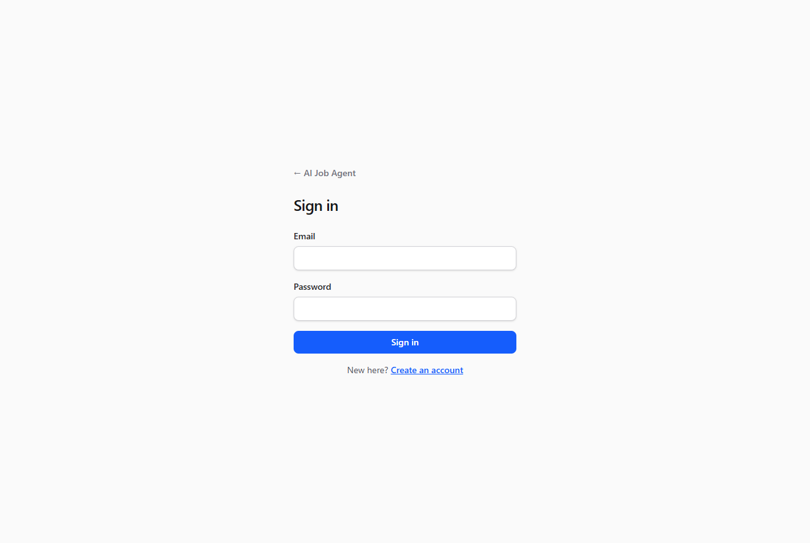

**Home.** Shortcuts to every part of the app.

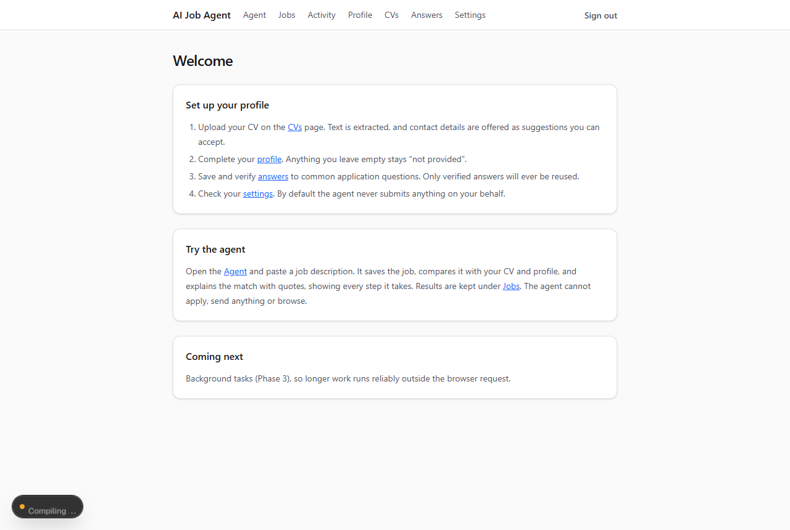

**CVs.** Upload your CV (PDF or Word). The worker extracts the text in a few seconds; detected
contact details appear as suggestions you accept or ignore. The primary CV is used for search
and matching.

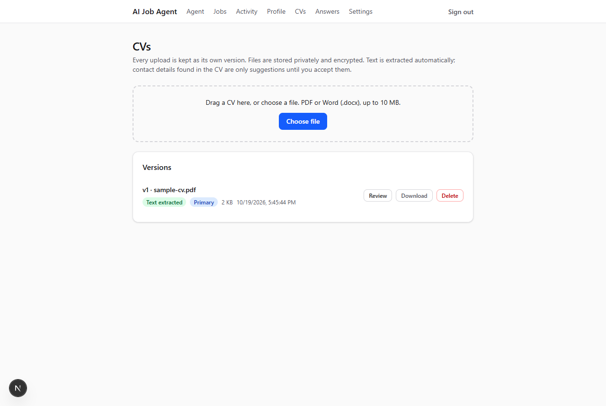

**Profile.** Your details: location, preferred countries, experience, skills. Countries and
current role are used to suggest job searches.

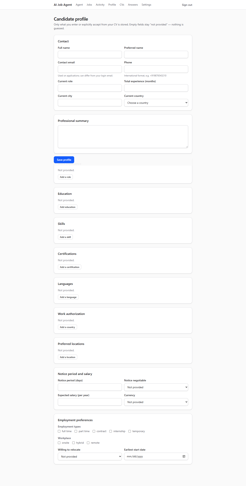

**Answers.** Verified answers to common application questions, for reuse later. The agent only
reuses answers you marked verified.

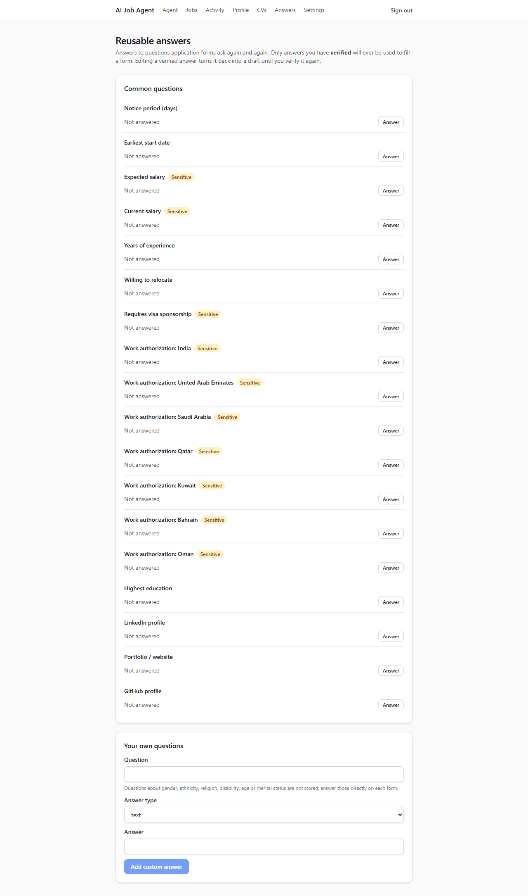

**Jobs → Find jobs for me.** Roles and countries are suggested from your CV; edit them (up to 3
roles, country codes such as `IN, AE, SA`) and press **Find jobs for me**. Open **Sources** to
see which job sources are on.

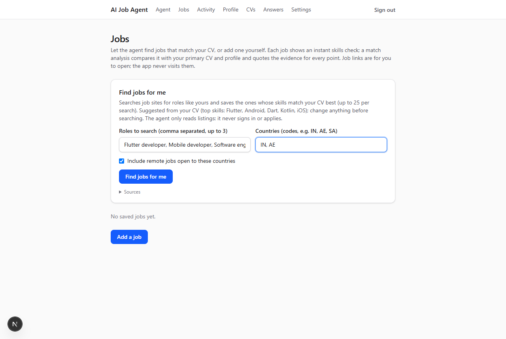

**Jobs list.** About 30 seconds later the best new jobs appear, sorted by **best match**, with the
instant skills score and where each job was found. Add a job yourself with **Add a job**.

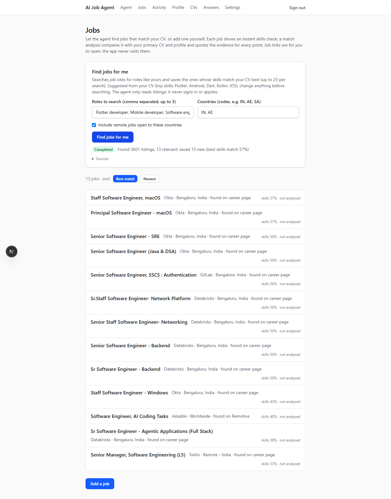

**A job.** The **Skills check** shows which skills from the job are in your CV and which are
missing (instant, no AI). **original posting** opens the employer's page, where you apply.
**Analyse match** starts the full AI analysis.

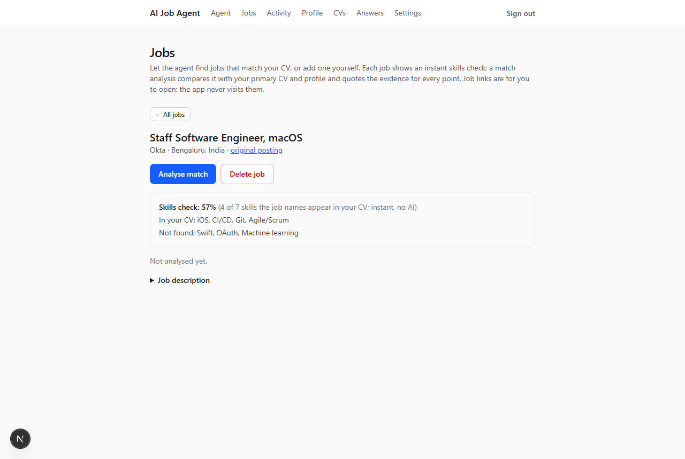

**Analysis running.** It runs in the background; you can leave the page. With the free local
model, expect 8–10 minutes, one analysis at a time.

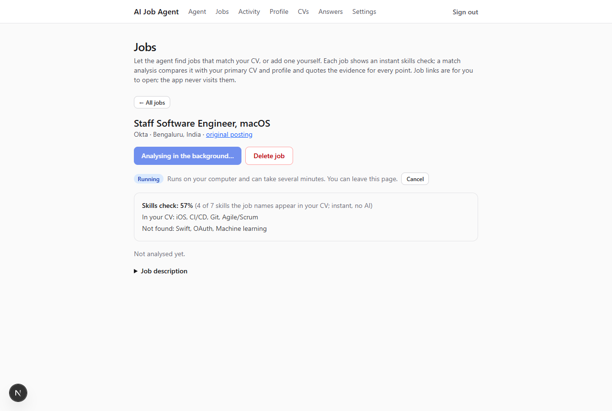

**Match result.** A score, a recommendation, and for each factor (skills, experience, location…)
the quote from the job and the quote from your CV that support it. Quotes are checked word for
word against the real texts; the score is computed by code, not guessed by the AI. (No
screenshot yet: the sample analysis ran out of memory on the laptop while screenshots were taken,
see Troubleshooting.)

**Activity.** Every background task: job searches, analyses, CV processing, with each step,
retry and error. Tasks continue after a restart and can be cancelled.

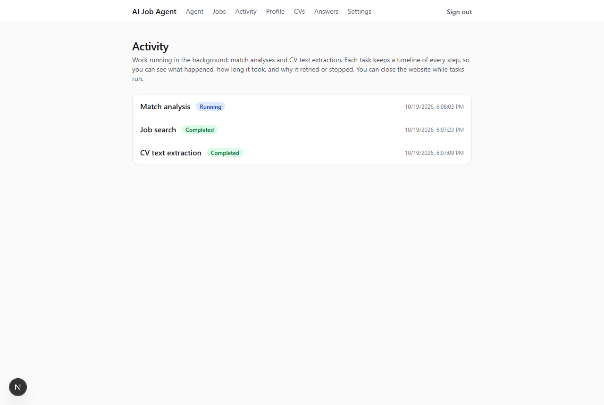

**Agent.** Chat with the agent: paste a job, ask how well it fits, ask what is missing from your
CV. It uses the same tools and never invents facts about you. Slow on a laptop model (minutes
per reply).

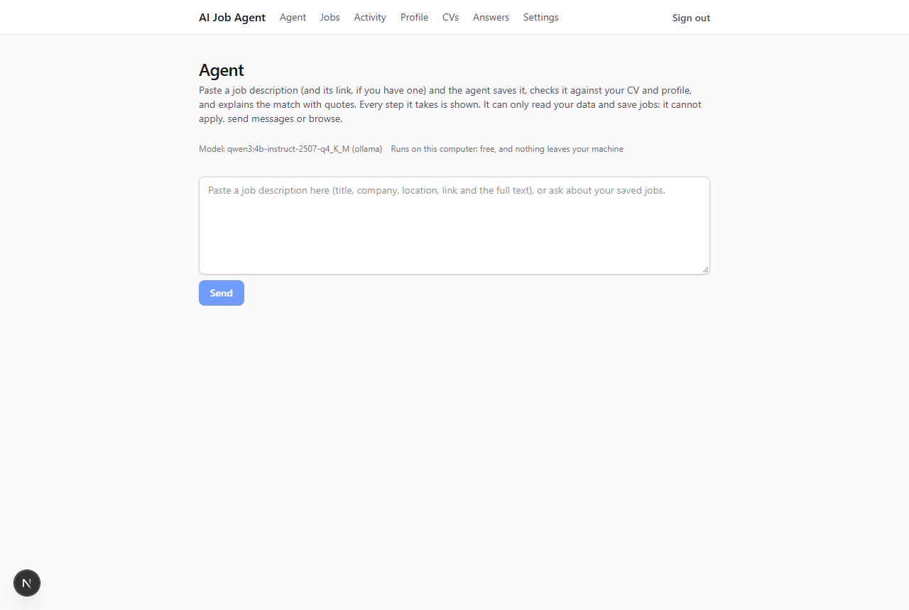

**Settings.** Allow or withdraw AI processing, see the AI model and usage.

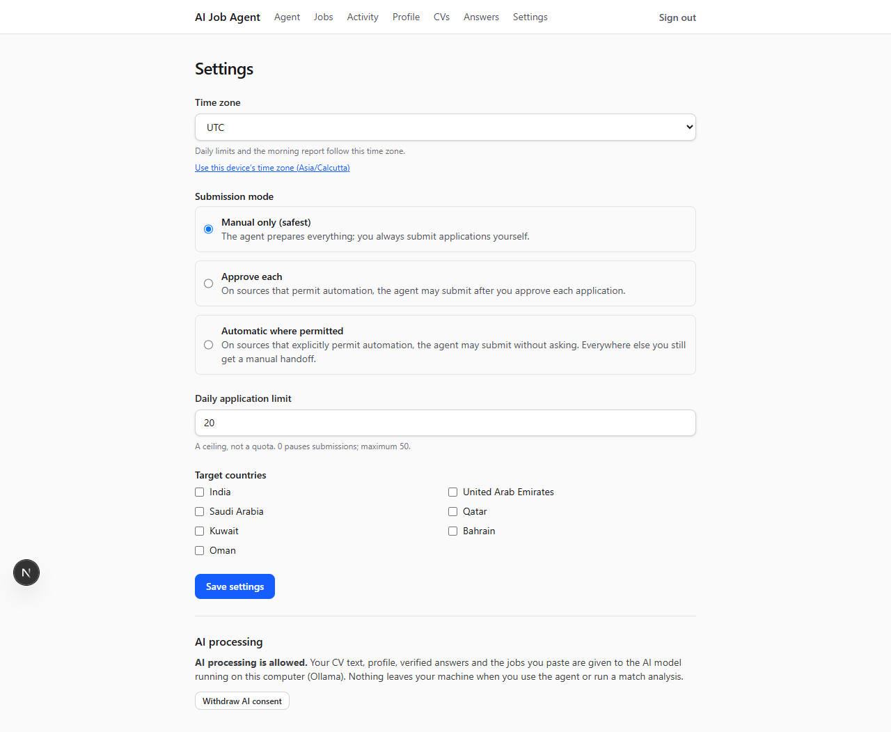

### Troubleshooting

| Problem                                                 | Fix                                                                                                                                                                                               |
| ------------------------------------------------------- | ------------------------------------------------------------------------------------------------------------------------------------------------------------------------------------------------- |
| Page shows a hydration warning                          | A browser extension changes the page. Use an Incognito window or disable the extension.                                                                                                           |
| Task stays "Queued"                                     | `pnpm dev` (the worker) is not running, or Docker is stopped: run `pnpm db:up`.                                                                                                                   |
| "Ollama is not running"                                 | Start Ollama (tray icon, or `ollama serve`).                                                                                                                                                      |
| Analysis times out ("did not finish within 15 minutes") | The model needs ~3 GB of free memory. Close browser tabs and other apps, then press **Analyse** again; or use the paid Anthropic model. Check free memory in Task Manager → Performance → Memory. |
| Page keeps reloading by itself                          | Fixed in `next.config.ts` (D-050). If it happens again, stop `pnpm dev`, delete `apps/web/.next`, start again.                                                                                    |
| JSearch shows `auth_required` on Activity               | The key in `.env` is wrong or not subscribed to JSearch; restart `pnpm dev` after fixing it.                                                                                                      |
| Port 3000 in use                                        | Another `pnpm dev` is running; stop it first.                                                                                                                                                     |

The `.env.example` database values match `docker-compose.yml` and are for local use only.
Docker creates two databases: `job_agent` (development) and `job_agent_test` (tests only).
Health details: web <http://localhost:3000/api/health>, worker <http://localhost:8081/health>
and <http://localhost:8081/ready>. A dependency shows `not_configured` when its variable is
empty; health checks never show a fake `up`.

## Repository layout

```
apps/
  web/             Next.js app: UI, auth, API route handlers (Vercel)
  worker/          Persistent Node.js worker: queues, schedules, retries, reports
  browser-agent/   Local agent on the user's machine (interfaces only so far)
  extension/       Chrome extension, Manifest V3 (README only so far)
packages/
  shared/                 Common types, Zod schemas, API + browser-agent protocol
  agent-core/             Task state machine, recovery rules, tool registry, orchestrator contract
  ai-providers/           Provider-neutral model interface and routing contracts
  job-sources/            Connector interface + deny-by-default source declarations
  job-processing/         Normalization, dedup, freshness, matching contracts
  application-workflows/  Preparation, form filling, verification, handoff contracts
  database/               Prisma schema + migrations, repositories, health probe
  documents/              CV validation by content, text extraction, contact suggestions
  storage/                Private object storage (local driver) + encryption wrapper
  security/               Auth context, ownership, policy engine, audit types, AES-256-GCM cipher
  notifications/          Approval requests, alerts, morning report contracts
  observability/          JSON logger with redaction, metrics interface
docs/
  architecture/    System design (start with system-overview.md)
  development/     Roadmap and architecture decisions
tests/
  e2e/             Playwright tests (HTTP-level)
  integration/     Cross-app integration tests (package-level ones live next to the code)
  fixtures/        Synthetic test data only
scripts/           Local tooling (Postgres init script for Docker)
```

## Everyday commands

| Command                                                      | What it does                                                                                                                                               |
| ------------------------------------------------------------ | ---------------------------------------------------------------------------------------------------------------------------------------------------------- |
| `pnpm check`                                                 | Format check, lint, typecheck and unit tests. Run before every commit.                                                                                     |
| `pnpm test:integration`                                      | Migrates the `*_test` database, then runs the database-backed tests                                                                                        |
| `pnpm test:e2e`                                              | Playwright (starts its own dev server on port 3100 against the test database). Stop any running `pnpm dev` first: Next allows only one dev server per app. |
| `pnpm build`                                                 | Production build of the web app                                                                                                                            |
| `pnpm db:up` / `pnpm db:down`                                | Start / stop local Postgres and Redis (data is kept in Docker volumes)                                                                                     |
| `pnpm db:migrate`                                            | Apply pending migrations (non-destructive `prisma migrate deploy`)                                                                                         |
| `pnpm db:migrate:dev`                                        | Create a new migration after editing `schema.prisma`                                                                                                       |
| `pnpm db:status`                                             | Show applied and pending migrations                                                                                                                        |
| `pnpm db:seed`                                               | Create or refresh the synthetic demo account                                                                                                               |
| `pnpm db:generate`                                           | Regenerate the Prisma client (also done automatically before typecheck/test/build)                                                                         |
| `pnpm lint` / `pnpm typecheck` / `pnpm test` / `pnpm format` | Individual checks                                                                                                                                          |

## Environment variables

All variables are listed with explanations in [`.env.example`](.env.example). **Never commit
real values.** Local development uses one `.env` at the repository root, which the web app, the
worker, Prisma and the test tools all read. Hosted environments use their own secret stores.
In production, sign-up is closed unless your email is in `AUTH_SIGNUP_ALLOWED_EMAILS`.

## Architecture docs

| Document                                                                    | Topic                                                |
| --------------------------------------------------------------------------- | ---------------------------------------------------- |
| [system-overview](docs/architecture/system-overview.md)                     | Components, cloud vs local, module boundaries        |
| [agent-execution-flow](docs/architecture/agent-execution-flow.md)           | How the agent loop plans, acts, observes, retries    |
| [application-state-machine](docs/architecture/application-state-machine.md) | Task states, transitions, durability rules           |
| [job-source-connectors](docs/architecture/job-source-connectors.md)         | Connector interface and capability registry          |
| [security-and-permissions](docs/architecture/security-and-permissions.md)   | Trust boundaries, authentication, approvals, secrets |
| [database-design](docs/architecture/database-design.md)                     | Implemented and proposed schema, indexes, retention  |
| [background-processing](docs/architecture/background-processing.md)         | Queue, checkpoints, retries, schedules               |
| [ai-provider-routing](docs/architecture/ai-provider-routing.md)             | Model switching, fallback, costs                     |
| [deployment](docs/architecture/deployment.md)                               | Vercel, worker host, managed services, local agent   |
| [implementation-roadmap](docs/development/implementation-roadmap.md)        | Phases and acceptance criteria                       |
| [decisions](docs/development/decisions.md)                                  | Architecture decision records                        |

## Safety principles (built in from the start)

- Every private record and action is scoped to the authenticated user.
- The agent never invents candidate information, and only reuses answers you have verified.
- Emails are never sent without your explicit approval of the exact content.
- Applications are submitted automatically only where the source **and** your settings
  explicitly allow it. Otherwise everything is prepared and handed to you.
- CAPTCHA, OTP, logins, access blocks and rate limits are never bypassed.
- A submission with an uncertain outcome is verified, never blindly retried.
