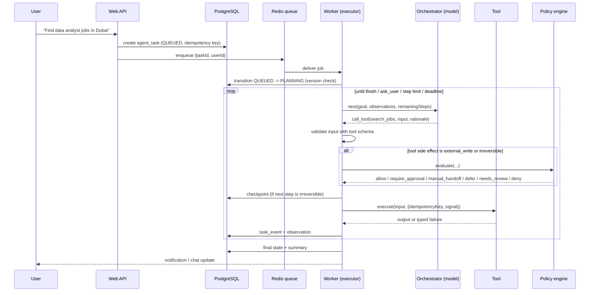

# Agent execution flow

> Status: contracts defined in `packages/agent-core` (`orchestrator.ts`, `tools.ts`,
> `recovery.ts`, `task-state.ts`). The loop itself is implemented in Phase 3 and connected to a
> model in Phase 4.

## The idea in one paragraph

An "AI agent" here is a loop. A model looks at the goal and what has happened so far, then
proposes the next action: call a tool, ask the user something, or finish. Our code (the
**executor**) checks the proposal and runs it if allowed, then records the result as an
**observation**. The loop repeats. The model never acts directly. It only proposes actions, and
the executor decides. That split keeps the agent safe and testable.

## Roles

| Role          | Where                            | Does                                                                                             |
| ------------- | -------------------------------- | ------------------------------------------------------------------------------------------------ |
| Orchestrator  | `AgentOrchestrator` (agent-core) | Proposes the next action from goal + observations. Can be a hand-written loop or LangGraph.js.   |
| Executor      | worker (Phase 3)                 | Validates and runs proposals, persists state, enforces limits.                                   |
| Tool registry | `ToolRegistry` (agent-core)      | The only actions that exist. Each tool has a Zod input/output schema and a declared side effect. |
| Policy engine | `packages/security/policy.ts`    | Decides whether an external action is allowed, needs approval, or becomes a manual handoff.      |
| State machine | `task-state.ts`                  | Legal task state transitions, persisted in PostgreSQL.                                           |
| Recovery      | `recovery.ts`                    | Bounded retry, handoff or failure after an error.                                                |

## Loop

## Step by step

1. **Goal intake.** The API validates the request, scopes it to the authenticated user, and
   creates a task with an idempotency key. A double-clicked "start" button creates one task.
2. **Planning.** The orchestrator receives the goal and the list of tools (name, description,
   side effect). It never sees secrets or other users' data. It returns `NextAction`.
3. **Tool selection.** `call_tool` names a registered tool. Unknown tools and inputs that fail
   schema validation are rejected and recorded as observations. They are never "best-effort"
   executed.
4. **Gatekeeping.** Before any tool with side effect `external_write` or `irreversible`, the
   executor:
   - checks the task state allows it (for example, submissions only from `READY_TO_SUBMIT`),
   - runs the policy engine with server-side data, not with values the model supplied,
   - writes a checkpoint so a crash can be resumed safely.
5. **Execution.** Every tool call has a timeout and an `AbortSignal` (for cancellation and
   deadlines), plus an idempotency key per task, step and attempt.
6. **Observation.** Output or a typed failure (`FailureKind`) is appended to the task history.
   Observations are what the user sees as "why the agent did this".
7. **Retries.** `decideRecovery` maps the failure to `retry` (with backoff and deadline),
   `needs_review`, `manual_handoff` or `fail`. An uncertain outcome is **never** retried; it
   goes to verification or review.
8. **Final response.** `finish` produces a summary. `ask_user` pauses the task (`NEEDS_REVIEW`)
   with a concrete question.

## Hard limits

| Limit                     | Purpose                                                                                              |
| ------------------------- | ---------------------------------------------------------------------------------------------------- |
| `remainingSteps` per task | Stops runaway loops. Reaching it ends in `NEEDS_REVIEW`, not silent failure.                         |
| Deadline per task         | No retry is scheduled past it.                                                                       |
| Max attempts per step     | Default 3 (`DEFAULT_RETRY_POLICY`).                                                                  |
| Per-tool timeout          | Declared on every `ToolDefinition`.                                                                  |
| AI budget                 | Router refuses calls over the monthly budget (see [ai-provider-routing.md](ai-provider-routing.md)). |
| Daily application limit   | Enforced by the policy engine in the user's time zone.                                               |

## Self-recovery: what it may and may not do

**May:** retry transient failures with backoff, switch to the next model in the fallback chain,
use a declared fallback source, wait out a rate limit, re-verify an uncertain submission, and
diagnose an error into a readable explanation for the morning report.

**May not:** change its own permissions or user settings, mark a source as automation-permitted,
bypass CAPTCHA, OTP, login or rate limits, invent candidate information, or retry a submission
whose outcome is unknown.

## LangGraph.js

`AgentOrchestrator` is intentionally small, so a LangGraph.js graph can implement it later. The
**task state machine in PostgreSQL stays the source of truth** for durable progress, even if
LangGraph's own checkpointer is used for conversation state. See decision D-005 in
[decisions.md](../development/decisions.md).
