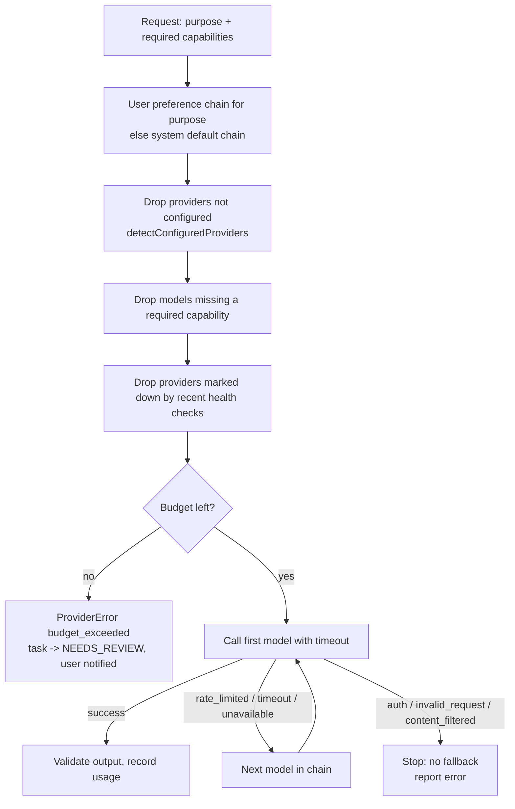

# AI provider routing

> Status: provider interface, error model, routing and usage ports, and configuration detection
> are **implemented** in `packages/ai-providers`. **No adapter calls any model yet** (Phase 4).

## Goals

- Switch between Claude (Anthropic API), Gemini (Google AI API), OpenAI API and any
  **OpenAI-compatible** endpoint (including local model servers), per purpose and per user.
- Fall back automatically when a provider is down or rate-limited.
- Keep spending under an explicit budget.
- Never let the rest of the code depend on one vendor's SDK.

**API access is required.** Consumer subscriptions (ChatGPT Plus, Claude.ai, Gemini apps) do
not include API keys and cannot be used. Each provider needs its own API key and billing.

## Contracts

```ts
interface ModelProvider {
  readonly id: 'anthropic' | 'google' | 'openai' | 'openai_compatible';
  supports(model: string, capability: ModelCapability): boolean;
  generate<T>(
    req: GenerateRequest<T>,
    opts: { model; signal; timeoutMs },
  ): Promise<GenerateResult<T>>;
  checkHealth(signal: AbortSignal): Promise<ProviderHealth>;
}

interface ModelRouter {
  resolve(req: { userId; purpose; requiredCapabilities }): Promise<ModelRef[]>; // ordered chain
}
```

- **Capabilities:** `text`, `structured_output`, `tool_calling`, `vision`, `long_context`. For
  example, CV parsing from images requires `vision`, and form mapping requires
  `structured_output`.
- **Purposes:** `chat`, `planning`, `cv_parsing`, `job_matching`, `document_generation`,
  `form_field_mapping`. Each purpose can use a different chain, so cheap models can do bulk
  matching while a stronger model writes cover letters.
- **Structured output:** when `responseSchema` (Zod) is set, the adapter asks for JSON and
  **validates** it. Invalid output counts as a failed call. It is never passed on partly parsed.

## Routing algorithm



`ProviderError.canFallback` is `true` only for `rate_limited`, `timeout` and `unavailable`.
Falling back on an invalid request would usually fail again and cost more. An auth error means a
configuration problem that the user must fix.

## Configuration

Environment variables (see `.env.example`). Model ids are **configuration**, never hard-coded in
business logic, because vendors rename and retire models.

| Provider                  | Key                                                                   | Default model                     |
| ------------------------- | --------------------------------------------------------------------- | --------------------------------- |
| Anthropic                 | `ANTHROPIC_API_KEY`                                                   | `ANTHROPIC_DEFAULT_MODEL`         |
| Google Gemini             | `GEMINI_API_KEY`                                                      | `GEMINI_DEFAULT_MODEL`            |
| OpenAI                    | `OPENAI_API_KEY`                                                      | `OPENAI_DEFAULT_MODEL`            |
| OpenAI-compatible / local | `OPENAI_COMPATIBLE_BASE_URL` (+ optional `OPENAI_COMPATIBLE_API_KEY`) | `OPENAI_COMPATIBLE_DEFAULT_MODEL` |

User preferences (`ai_provider_preferences`) can only choose among providers the operator has
configured. Users cannot add arbitrary base URLs in Phase 4, which prevents server-side request
forgery.

**Local models:** a model server on the user's machine is not reachable from the cloud worker.
Use one either from a worker running on the same machine or network, or through a
self-hosted endpoint the worker can reach. This is documented, not hidden.

## Timeouts

Every call has a timeout and an `AbortSignal`. The defaults per purpose are configured with the
adapters. Cancelling a task aborts its in-flight model call.

## Cost controls

1. Every call writes an `ai_usage_records` row: tokens, purpose, model, estimated cost.
2. `AI_MONTHLY_BUDGET_USD` is a hard ceiling. **If it is empty, no AI calls are allowed.** Spend
   is never unbounded by accident.
3. A warning notification is sent at 80% of the budget. At 100%, routing refuses further calls.
4. Bulk work (matching many jobs) uses the cheapest capable model in the chain and caches
   results per `(job, cv_version)`.
5. Prompt caching and batching are used where the provider supports them (Phase 4 detail).
6. The morning report shows spend against budget.

## Data handling

- Prompts include only what the step needs: CV sections relevant to the job, never the whole
  history.
- Job descriptions are passed as **quoted, untrusted content** (see prompt-injection defence in
  [security-and-permissions.md](security-and-permissions.md)).
- API keys are read from the environment by adapters only. They are never logged (the logger
  redacts `*apiKey`/`*token`) and never sent to the browser.
