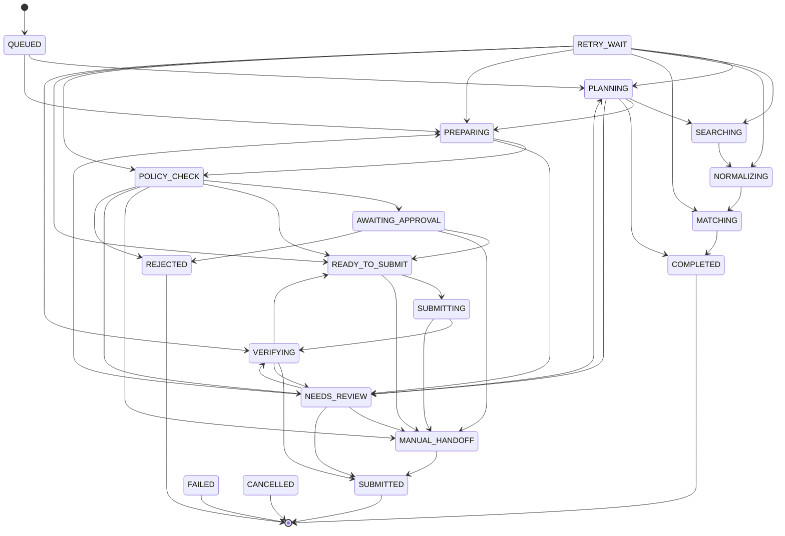

# Task / application state machine

> Status: **implemented** as data + guard functions in
> `packages/agent-core/src/task-state.ts`, with tests in `task-state.test.ts`. Persistence and
> the executor that drives it arrive in Phase 3. If this document and the code disagree, the code
> is authoritative and this document must be fixed.

## Task kinds

One state machine serves all task kinds. Each kind uses a subset of it.

| Kind                                              | Typical path                                                                                                |
| ------------------------------------------------- | ----------------------------------------------------------------------------------------------------------- |
| `job_match_analysis`, `cv_processing` (Phase 3)   | `QUEUED → RUNNING → COMPLETED` (or `RETRY_WAIT → RUNNING`, `NEEDS_REVIEW`, `FAILED`, `CANCELLED`)           |
| `daily_discovery`                                 | `QUEUED → PLANNING → SEARCHING → NORMALIZING → MATCHING → COMPLETED` (spawns child `job_application` tasks) |
| `job_application`                                 | `QUEUED → PREPARING → POLICY_CHECK → … → SUBMITTED` or `MANUAL_HANDOFF → SUBMITTED`                         |
| `cv_analysis`, `email_outreach`, `morning_report` | `QUEUED → PLANNING → … → COMPLETED` (email sending also passes `POLICY_CHECK` + `AWAITING_APPROVAL`)        |

**Deviation:** the requested state list had no success state for tasks that do not submit
anything, such as discovery. **`COMPLETED`** was added for those (decision D-009).

## Diagram

To keep the diagram readable, it leaves out the edges into `RETRY_WAIT`, `FAILED` and
`CANCELLED`. The table below is complete.

## Transition table

| From                                                        | Allowed next states                                                                                                |
| ----------------------------------------------------------- | ------------------------------------------------------------------------------------------------------------------ |
| `QUEUED`                                                    | RUNNING, PLANNING, PREPARING, CANCELLED                                                                            |
| `RUNNING` (single-step tasks, D-041)                        | COMPLETED, RETRY_WAIT, NEEDS_REVIEW, FAILED, CANCELLED                                                             |
| `PLANNING`                                                  | SEARCHING, PREPARING, COMPLETED, NEEDS_REVIEW, RETRY_WAIT, FAILED, CANCELLED                                       |
| `SEARCHING`                                                 | NORMALIZING, RETRY_WAIT, FAILED, CANCELLED                                                                         |
| `NORMALIZING`                                               | MATCHING, RETRY_WAIT, FAILED, CANCELLED                                                                            |
| `MATCHING`                                                  | COMPLETED, RETRY_WAIT, FAILED, CANCELLED                                                                           |
| `PREPARING`                                                 | POLICY_CHECK, NEEDS_REVIEW, RETRY_WAIT, FAILED, CANCELLED                                                          |
| `POLICY_CHECK`                                              | AWAITING_APPROVAL, READY_TO_SUBMIT, MANUAL_HANDOFF, NEEDS_REVIEW, RETRY_WAIT, REJECTED, CANCELLED                  |
| `AWAITING_APPROVAL`                                         | READY_TO_SUBMIT, MANUAL_HANDOFF, REJECTED, CANCELLED                                                               |
| `READY_TO_SUBMIT`                                           | SUBMITTING, MANUAL_HANDOFF, RETRY_WAIT, CANCELLED                                                                  |
| `SUBMITTING`                                                | VERIFYING, MANUAL_HANDOFF, RETRY_WAIT, FAILED                                                                      |
| `VERIFYING`                                                 | SUBMITTED, READY_TO_SUBMIT, NEEDS_REVIEW, RETRY_WAIT, FAILED                                                       |
| `MANUAL_HANDOFF`                                            | SUBMITTED, CANCELLED                                                                                               |
| `NEEDS_REVIEW`                                              | PLANNING, PREPARING, VERIFYING, MANUAL_HANDOFF, SUBMITTED, FAILED, CANCELLED                                       |
| `RETRY_WAIT`                                                | PLANNING, SEARCHING, NORMALIZING, MATCHING, PREPARING, POLICY_CHECK, READY_TO_SUBMIT, VERIFYING, FAILED, CANCELLED |
| `SUBMITTED`, `COMPLETED`, `FAILED`, `REJECTED`, `CANCELLED` | — (terminal)                                                                                                       |

## Meaning of each state

| State                                    | Meaning                                                                                     |
| ---------------------------------------- | ------------------------------------------------------------------------------------------- |
| `QUEUED`                                 | Created and waiting for a worker.                                                           |
| `RUNNING`                                | A worker is working on a single-step task; it holds a lease it renews every 20 s.           |
| `PLANNING`                               | Orchestrator deciding what to do.                                                           |
| `SEARCHING` / `NORMALIZING` / `MATCHING` | Discovery pipeline stages.                                                                  |
| `PREPARING`                              | Tailored CV, cover letter and verified answers being assembled.                             |
| `POLICY_CHECK`                           | Policy engine evaluating source capability, user settings, limits, blockers.                |
| `AWAITING_APPROVAL`                      | Waiting for the user to approve this exact content (bound to a content hash).               |
| `READY_TO_SUBMIT`                        | Approved or permitted; waiting for a submission slot.                                       |
| `SUBMITTING`                             | The irreversible step is in progress.                                                       |
| `VERIFYING`                              | Establishing whether the submission actually happened.                                      |
| `SUBMITTED`                              | Confirmed with evidence (confirmation page, email, portal status) or confirmed by the user. |
| `MANUAL_HANDOFF`                         | Everything is prepared; the user completes the step themselves.                             |
| `NEEDS_REVIEW`                           | Missing or unverified information, or an inconclusive outcome; the user must look.          |
| `RETRY_WAIT`                             | Waiting before retrying a step, or deferred (daily limit, unhealthy source, agent offline). |
| `COMPLETED`                              | Non-submission task finished successfully.                                                  |
| `FAILED`                                 | Stopped after a permanent error or exhausted retries.                                       |
| `REJECTED`                               | The user denied approval, or policy denied the action (for example a duplicate submission). |
| `CANCELLED`                              | The user cancelled.                                                                         |

Policy effects map onto states like this: `allow` → `READY_TO_SUBMIT`, `require_approval` →
`AWAITING_APPROVAL`, `manual_handoff` → `MANUAL_HANDOFF`, `defer` → `RETRY_WAIT` (does not
consume a retry attempt), `needs_review` → `NEEDS_REVIEW`, `deny` → `REJECTED`.

## Durability rules

1. **Atomic transitions.** A transition is one transaction: update `agent_tasks.state` where
   `id`, `user_id` and `version` match, then insert a `task_events` row. Optionally insert a
   `task_checkpoints` row. If zero rows are updated, another worker moved the task first and
   this worker stops.
2. **Persist before irreversible actions.** Entering `SUBMITTING` requires a checkpoint. The
   submit step writes `external_action_dispatched_at` **before** it clicks or calls submit.
3. **Resume after restart.** A reconciler finds non-terminal tasks without an active queue job
   and re-enqueues them. Resume behaviour depends on the last state:
   - `SUBMITTING` with `external_action_dispatched_at` set, or unknown → go to `VERIFYING`.
     **Never submit again.**
   - `SUBMITTING` with proof that nothing was dispatched → `RETRY_WAIT` (or `FAILED` if attempts
     are exhausted).
   - Any other state → re-run that step. Steps are idempotent by design.
4. **Idempotency.**
   - Tasks: `UNIQUE (user_id, idempotency_key)`.
   - Queue jobs: the job id is derived from the task id and step, so duplicates collapse.
   - Tool calls: an idempotency key per task, step and attempt is passed downstream.
5. **Duplicate-submission protection.** Applications have `UNIQUE (user_id, job_id)`. A
   submission attempt first inserts a `submission_attempts` row with a unique idempotency key.
   The policy engine denies when the application is already submitted.
6. **Bounded retries.** `failed_attempts` < `max_attempts`, and no retry is scheduled after
   `deadline_at` (see `decideRecovery`).
7. **Cancellation.** Cancelling sets `cancel_requested_at`. In interruptible states the executor
   aborts the step's `AbortSignal` and moves to `CANCELLED`. In `SUBMITTING` and `VERIFYING` the
   request is honoured **after** the outcome is known, because cancelling halfway would leave the
   outcome uncertain.
8. **Deadlines.** Every task has a `deadline_at`. When it passes, the next transition goes to
   `FAILED` (or `NEEDS_REVIEW` if verification is pending).

## Error handling summary

| Failure kind                               | Next state                                                                                                      |
| ------------------------------------------ | --------------------------------------------------------------------------------------------------------------- |
| `transient`, `rate_limited`                | `RETRY_WAIT` (backoff, honours Retry-After), then the same step; `FAILED` when attempts or the deadline run out |
| `permanent`                                | `FAILED`                                                                                                        |
| `blocked_needs_user` (CAPTCHA, OTP, login) | `MANUAL_HANDOFF`                                                                                                |
| `uncertain_outcome`                        | `VERIFYING` / `NEEDS_REVIEW`; never retried blindly                                                             |
| `policy_denied`                            | `REJECTED` (from `POLICY_CHECK`) or `FAILED`                                                                    |
