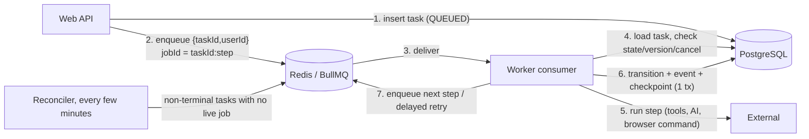

# Background processing

> Status (Phase 3): the task store, the BullMQ adapter (`packages/task-queue`), the worker's
> consumers, leases, reconciler and graceful shutdown are **implemented** for the
> `agent-tasks` queue (match analysis, CV processing). The other queues and the schedules are
> **not implemented yet** (Phases 6 and 11). Decisions D-041 to D-047.

## Why a separate worker

Vercel functions are request-scoped and time-limited. Overnight runs, retries with backoff and
browser-agent coordination need a process that stays up. `apps/worker` runs on a host that keeps
processes alive (see [deployment.md](deployment.md)), so work continues after the user closes
the website.

## Responsibilities split

| Concern                                  | Owner                                                                                           |
| ---------------------------------------- | ----------------------------------------------------------------------------------------------- |
| What the task is, and its state          | **PostgreSQL** (`agent_tasks`, `task_events`, `task_checkpoints`). This is the source of truth. |
| When to run it next, and on which worker | **Redis + BullMQ**. Delivery and scheduling only.                                               |

Queue messages carry only `{ taskId, userId }`. If Redis loses data, a **reconciler** rebuilds
the queue from PostgreSQL. No progress is lost.

## Queues (planned)

| Queue               | Jobs                                                     | Concurrency (initial)                                 |
| ------------------- | -------------------------------------------------------- | ----------------------------------------------------- |
| `agent-tasks`       | One step of an agent task (CV processing, job search)    | 4 per worker                                          |
| `ai-tasks` ✅       | Tasks that call an AI model (match analysis)             | 1 with a local model (D-048), else WORKER_CONCURRENCY |
| `connector-runs`    | Source searches. The per-source rate limiter lives here. | 1 per source                                          |
| `scheduled-reports` | Morning reports, retention clean-up                      | 1                                                     |
| `notifications`     | Approval requests, alerts, emails to the user            | 2                                                     |

BullMQ's per-queue rate limiter and per-source job groups enforce each source's declared
`rateLimit`. Connectors are never run in parallel against the same source.

## Durable checkpoints

- A step that is about to perform an **irreversible** action first writes a checkpoint in the
  same transaction as its state change (`READY_TO_SUBMIT → SUBMITTING`).
- The submit step sets `external_action_dispatched_at` **immediately before** dispatching.
- After a crash, the resume rules in
  [application-state-machine.md](application-state-machine.md#durability-rules) apply. In
  particular, an interrupted submission is **verified, never repeated**.

## Retries

- Retry logic lives in our own `decideRecovery` (`packages/agent-core/src/recovery.ts`), not in
  BullMQ's automatic retries. The worker therefore always records why it retries and keeps the
  task in `RETRY_WAIT` with `next_run_at`, which the UI shows.
- BullMQ `attempts` stays at 1 for task steps. Redis-level redelivery after a worker crash goes
  through the reconciler and the state and version checks, so a step never runs twice
  concurrently.
- Backoff: exponential with jitter (`backoffDelayMs`), honouring `Retry-After`, bounded by
  `max_attempts` and `deadline_at`.
- Deferrals (daily limit reached, source unhealthy, local agent offline) use `RETRY_WAIT` and do
  **not** increase `failed_attempts`.

## Cancellation

The user cancels, which sets `cancel_requested_at`. A consumer checks the flag before each step
and passes an `AbortSignal` into tools. In `SUBMITTING` and `VERIFYING`, cancellation is deferred
until the outcome is known.

## Scheduling

- **Per-user schedules** are BullMQ job schedulers created from `user_settings`, with the
  user's IANA time zone:
  - daily discovery run (default 01:00 local),
  - morning report (default `morning_report_local_time`, 08:00 local).
- Changing settings upserts the scheduler. Deleting an account removes it.
- The daily target (20) is a ceiling: the run spreads submissions across the night and stops at
  the limit (see slot reservation in [database-design.md](database-design.md)).

## Morning report

Built from `daily_stats`, `task_events`, `applications`, `approval_requests` and connector
health for the user's previous local day. It contains:

- jobs discovered, applications submitted (with evidence), manual handoffs waiting, approvals
  waiting, items needing review;
- blockers (CAPTCHA, OTP, login required) and what the user must do;
- source or provider problems and what the agent tried (diagnosis from the task events);
- AI spend against budget.

It is delivered in-app, and by email if enabled. Sending the report email to the user's own
address is a notification, not outreach, so the per-message approval rule for emails to
companies does not apply. The user opts in once in settings.

## Health, readiness and graceful shutdown (implemented)

| Endpoint      | Current behaviour (Phase 2)                                     | Target behaviour                                         |
| ------------- | --------------------------------------------------------------- | -------------------------------------------------------- |
| `GET /health` | Real DB probe (`up`/`down`, 503 when down); Redis `not_checked` | Probes DB and Redis (`up` / `down`)                      |
| `GET /ready`  | Always `503`: no consumers yet                                  | `200` when consumers are running and dependencies are up |

On `SIGTERM`/`SIGINT` the worker stops accepting work, closes the health server and exits, with
a 10-second hard limit. In Phase 3, shutdown first stops the consumers and waits for in-flight
steps. A step that cannot finish in time is left to the reconciler. It is not killed mid-way
through a submission.
