# Database design

## Implemented vs proposed

|                           | Status                                                                                                                                                                                                                                                                                           |
| ------------------------- | ------------------------------------------------------------------------------------------------------------------------------------------------------------------------------------------------------------------------------------------------------------------------------------------------ |
| **Implemented (Phase 2)** | Migration `20261018120000_init` in `packages/database/prisma/migrations`: `users`, `sessions`, `accounts`, `verifications`, `auth_rate_limits`, `user_settings`, `candidate_profiles` (minimal: `headline`, `summary`), `audit_logs`. Source of truth: `packages/database/prisma/schema.prisma`. |
| **Proposed**              | Everything else below. Phase 3 adds the task tables; later phases add the rest.                                                                                                                                                                                                                  |

Database: PostgreSQL 17 (Docker locally). ORM and migrations: Prisma 7.10 with the `pg` driver
adapter.

### Implemented details worth knowing

- **Auth tables follow Better Auth's model shape** (`user`, `session`, `account`,
  `verification`, `rateLimit`) and are mapped to snake_case table names. Passwords are stored
  only as scrypt hashes in `accounts.password`. Verification identifiers are stored hashed.
  Session tokens are stored in plain form, because Better Auth looks sessions up by token
  (decision D-017).
- **`time_zone` lives in `user_settings`**, not `users`, because it is a user-editable setting
  (decision D-020).
- **Rules that Prisma cannot express are hand-written in the migration:**
  - `CHECK (daily_application_limit BETWEEN 0 AND 50)` and `CHECK (cardinality(target_countries) <= 30)`.
  - A trigger rejects any `UPDATE` on `audit_logs`, making it append-only. Deletion happens only
    through account deletion (cascade) or the future retention job.
- **Settings changes and their audit entry are written in one transaction.** The audit
  metadata lists changed field names only, never values.
- **Ids** are UUIDs generated by Prisma (`@default(uuid())`). Better Auth is configured with
  `generateId: "uuid"`.

## Conventions

- **Primary keys:** `uuid` (generated by the application or with `gen_random_uuid()`). Exceptions:
  `job_sources.id` is the stable text `SourceId`, and composite keys are used where noted.
- **Ownership:** every private table has `user_id uuid not null references users(id) on delete
cascade`, and every query filters by it. Indexes on private tables **start with `user_id`**.
- **Timestamps:** `timestamptz`, stored in **UTC**. `created_at` and `updated_at` everywhere.
  Business "days" (daily limits, reports) are computed in the user's `time_zone`.
- **Optimistic concurrency:** mutable workflow rows (`agent_tasks`, `applications`) have an
  integer `version`.
- **Files:** never in the database and never in a public folder. Tables store a private
  object-storage `storage_key`, plus `sha256` and size. Downloads use short-lived signed URLs
  after an ownership check.
- **Enums:** stored as text with check constraints (or Prisma enums), mirrored by Zod enums in
  code.

## Entity overview

```mermaid
erDiagram
  users ||--|| user_settings : has
  users ||--|| candidate_profiles : has
  candidate_profiles ||--o{ cv_versions : versions
  users ||--o{ profile_answers : verified
  users ||--o{ generated_documents : owns
  job_sources ||--o{ connector_runs : runs
  users ||--o{ connector_runs : requested
  jobs ||--o{ job_sightings : "seen on"
  job_sources ||--o{ job_sightings : lists
  users ||--o{ job_matches : scored
  jobs ||--o{ job_matches : "matched to"
  users ||--o{ applications : tracks
  jobs ||--o{ applications : "applied to"
  applications ||--o{ application_answers : uses
  applications ||--o{ submission_attempts : attempts
  applications ||--o{ application_evidence : proves
  users ||--o{ email_drafts : drafts
  email_drafts ||--o{ email_deliveries : delivered
  users ||--o{ agent_tasks : runs
  agent_tasks ||--o{ task_events : history
  agent_tasks ||--o{ task_attempts : attempts
  agent_tasks ||--o{ task_checkpoints : checkpoints
  agent_tasks ||--o{ approval_requests : asks
  users ||--o{ ai_provider_preferences : prefers
  users ||--o{ ai_usage_records : spends
  users ||--o{ browser_agents : registers
  browser_agents ||--o{ browser_agent_heartbeats : reports
  browser_agents ||--o{ browser_commands : executes
  users ||--o{ notifications : receives
  users ||--o{ audit_logs : audited
  users ||--o{ daily_stats : "per local day"
```

## Tables

✅ = implemented in Phase 2. Everything else is proposed.

### Identity and settings

| Table                                                          | Key columns                                                                                                                                                                                                                                                                                                                | Constraints and indexes                                                                    |
| -------------------------------------------------------------- | -------------------------------------------------------------------------------------------------------------------------------------------------------------------------------------------------------------------------------------------------------------------------------------------------------------------------- | ------------------------------------------------------------------------------------------ |
| `users` ✅                                                     | `id`, `name`, `email` (lower-cased by Better Auth), `email_verified`, `image`                                                                                                                                                                                                                                              | `unique(email)`                                                                            |
| `sessions`, `accounts`, `verifications`, `auth_rate_limits` ✅ | Better Auth shapes (see above)                                                                                                                                                                                                                                                                                             | `unique(sessions.token)`, `unique(accounts.provider_id, account_id)`, indexes on `user_id` |
| `user_settings` ✅                                             | `user_id` (PK/FK), `time_zone` (IANA, default `UTC`), `submission_mode` (`manual_only` / `approve_each` / `auto_where_permitted`, default `manual_only`), `daily_application_limit` (default 20, check 0–50), `target_countries text[]`. **Proposed later:** `morning_report_local_time`, `notification_preferences jsonb` |                                                                                            |

### Candidate profile and documents

| Table                             | Key columns                                                                                                                                                                             | Constraints and indexes                                                                           |
| --------------------------------- | --------------------------------------------------------------------------------------------------------------------------------------------------------------------------------------- | ------------------------------------------------------------------------------------------------- |
| `candidate_profiles` ✅ (partial) | `id`, `user_id`, `headline`, `summary` (implemented); proposed: `years_experience`, `skills text[]`, `preferred_locations text[]`, `work_authorization jsonb`, `current_cv_version_id`  | `unique(user_id)` (one profile per user for now)                                                  |
| `cv_versions`                     | `id`, `user_id`, `profile_id`, `version`, `storage_key`, `original_filename`, `mime_type`, `size_bytes`, `sha256`, `parse_status`, `parsed jsonb`                                       | `unique(profile_id, version)`, `unique(user_id, sha256)`, index `(user_id, created_at)`           |
| `generated_documents`             | `id`, `user_id`, `kind` (`tailored_cv` / `cover_letter`), `source_cv_version_id`, `job_id`, `storage_key`, `content_hash`, `model_provider`, `model`, `approved_at`                     | index `(user_id, job_id)`                                                                         |
| `profile_answers`                 | `id`, `user_id`, `field_key` (e.g. `notice_period_days`), `question_text`, `answer`, `answer_type`, `origin` (`user_entered` / `cv_extracted_confirmed`), `verified_at`, `last_used_at` | `unique(user_id, field_key)`. Only rows with `verified_at is not null` may be used to fill forms. |

### Sources and jobs

| Table                  | Key columns                                                                                                                                                                             | Constraints and indexes                                                 |
| ---------------------- | --------------------------------------------------------------------------------------------------------------------------------------------------------------------------------------- | ----------------------------------------------------------------------- |
| `job_sources`          | `id` (text `SourceId`), `display_name`, `declaration jsonb` (copy of the code registry, for history), `implementation_status`                                                           | Reference data. The code registry is authoritative.                     |
| `user_source_settings` | `user_id`, `source_id`, `enabled`                                                                                                                                                       | PK `(user_id, source_id)`                                               |
| `connector_runs`       | `id`, `user_id`, `source_id`, `task_id`, `status`, `started_at`, `finished_at`, `jobs_found`, `error_code`, `error_message`                                                             | index `(source_id, started_at)` for health, `(user_id, started_at)`     |
| `jobs`                 | `id`, `fingerprint`, `title`, `company`, `locations jsonb`, `workplace`, `employment_type`, `description`, `salary jsonb`, `posted_at`, `apply_url`, `freshness_status`, `last_seen_at` | `unique(fingerprint)`, index `(last_seen_at)`                           |
| `job_sightings`        | `id`, `job_id`, `source_id`, `external_id`, `url`, `raw_payload_key`, `first_seen_at`, `last_seen_at`                                                                                   | `unique(source_id, external_id)`                                        |
| `job_matches`          | `id`, `user_id`, `job_id`, `cv_version_id`, `score`, `recommendation`, `factors jsonb`, `gaps jsonb`                                                                                    | `unique(user_id, job_id, cv_version_id)`, index `(user_id, score desc)` |

`jobs` and `job_sightings` hold **public posting data** and have no `user_id`. A job seen by two
users is stored once. Everything user-specific about a job (matches, applications) is in
user-owned tables.

### Applications and email

| Table                  | Key columns                                                                                                                                                                                                                               | Constraints and indexes                                                                                                                |
| ---------------------- | ----------------------------------------------------------------------------------------------------------------------------------------------------------------------------------------------------------------------------------------- | -------------------------------------------------------------------------------------------------------------------------------------- |
| `applications`         | `id`, `user_id`, `job_id`, `task_id`, `status` (see below), `source_id`, `company_snapshot`, `title_snapshot`, `cv_document_id`, `cover_letter_document_id`, `content_hash`, `submitted_at`, `submitted_by` (`agent` / `user`), `version` | **`unique(user_id, job_id)`** (duplicate protection), index `(user_id, status, updated_at)`, `(user_id, submitted_at)`                 |
| `application_answers`  | `id`, `user_id`, `application_id`, `field_key`, `field_label`, `value_snapshot`, `profile_answer_id`                                                                                                                                      | index `(application_id)`                                                                                                               |
| `submission_attempts`  | `id`, `user_id`, `application_id`, `task_id`, **`idempotency_key`**, `dispatched_at`, `outcome` (`pending` / `confirmed` / `not_submitted` / `uncertain`), `verified_at`                                                                  | **`unique(idempotency_key)`**, partial unique `(application_id) where outcome in ('pending','uncertain')` (only one attempt in flight) |
| `application_evidence` | `id`, `user_id`, `application_id`, `kind`, `storage_key`, `summary`, `captured_at`                                                                                                                                                        | index `(application_id)`                                                                                                               |
| `email_drafts`         | `id`, `user_id`, `application_id`, `to_address`, `subject`, `body`, `content_hash`, `status` (`draft` / `awaiting_approval` / `approved` / `sent` / `failed` / `cancelled`), `approval_request_id`                                        | index `(user_id, status)`                                                                                                              |
| `email_deliveries`     | `id`, `user_id`, `draft_id`, `provider`, `provider_message_id`, `status`, `sent_at`, `error_code`                                                                                                                                         | `unique(draft_id)`: one send per approved draft                                                                                        |

**Application status vs task state.** `applications.status` is the user-facing tracker:
`preparing`, `awaiting_approval`, `ready`, `manual_handoff`, `submitted`, `withdrawn`, and
after submission `viewed`, `interview`, `offer`, `rejected_by_employer`. `agent_tasks.state`
describes the agent's **work** on it. They are linked by `task_id`, but they are separate
fields.

### Agent tasks

| Table               | Key columns                                                                                                                                                              | Constraints and indexes                                                                                     |
| ------------------- | ------------------------------------------------------------------------------------------------------------------------------------------------------------------------ | ----------------------------------------------------------------------------------------------------------- |
| `agent_tasks`       | `id`, `user_id`, `kind`, `state`, `parent_task_id`, `idempotency_key`, `failed_attempts`, `max_attempts`, `deadline_at`, `next_run_at`, `cancel_requested_at`, `version` | **`unique(user_id, idempotency_key)`**, index `(user_id, state)`, `(state, next_run_at)` for the reconciler |
| `task_events`       | `id`, `task_id`, `user_id`, `from_state`, `to_state`, `reason`, `failure_kind`, `failure_message`, `created_at`                                                          | index `(task_id, created_at)`. Append-only.                                                                 |
| `task_attempts`     | `id`, `task_id`, `user_id`, `step`, `attempt`, `started_at`, `finished_at`, `outcome`, `failure_kind`                                                                    | `unique(task_id, step, attempt)`                                                                            |
| `task_checkpoints`  | `id`, `task_id`, `user_id`, `state`, `step`, `external_action_dispatched_at`, `data jsonb`                                                                               | index `(task_id, created_at desc)`                                                                          |
| `approval_requests` | `id`, `user_id`, `task_id`, `action` (`submit_application` / `send_email`), `summary`, `content_hash`, `status`, `expires_at`, `decided_at`                              | index `(user_id, status)`, partial unique `(task_id, action) where status = 'pending'`                      |

### AI, browser agents, notifications, audit, stats

| Table                      | Key columns                                                                                                                                                              | Constraints and indexes                                                                                                              |
| -------------------------- | ------------------------------------------------------------------------------------------------------------------------------------------------------------------------ | ------------------------------------------------------------------------------------------------------------------------------------ |
| `ai_provider_preferences`  | `user_id`, `purpose`, `chain jsonb` (ordered `{provider, model}`)                                                                                                        | PK `(user_id, purpose)`                                                                                                              |
| `ai_usage_records`         | `id`, `user_id`, `task_id`, `provider`, `model`, `purpose`, `input_tokens`, `output_tokens`, `estimated_cost_usd numeric(12,6)`, `succeeded`, `latency_ms`, `created_at` | index `(user_id, created_at)`                                                                                                        |
| `browser_agents`           | `id`, `user_id`, `kind` (`local_agent` / `extension`), `name`, `credential_hash`, `agent_version`, `last_seen_at`, `revoked_at`                                          | `unique(credential_hash)`, index `(user_id)`                                                                                         |
| `browser_agent_heartbeats` | `id`, `agent_id`, `user_id`, `observed_at`, `agent_version`, `supported_commands text[]`                                                                                 | index `(agent_id, observed_at desc)`                                                                                                 |
| `browser_commands`         | `id`, `user_id`, `agent_id`, `task_id`, `type`, `idempotency_key`, `issued_at`, `expires_at`, `status`, `result jsonb`                                                   | `unique(idempotency_key)`, index `(agent_id, status, issued_at)`                                                                     |
| `notifications`            | `id`, `user_id`, `kind`, `title`, `body`, `action_path`, `dedupe_key`, `read_at`                                                                                         | `unique(user_id, dedupe_key)`                                                                                                        |
| `audit_logs` ✅            | `id`, `user_id`, `actor`, `action`, `target_type`, `target_id`, `metadata jsonb`, `occurred_at`                                                                          | index `(user_id, occurred_at)`. ✅ Append-only: an `UPDATE` trigger rejects changes; deletes only via account deletion or retention. |
| `daily_stats`              | `user_id`, `local_date`, `time_zone`, `submissions_reserved`, `applications_submitted`, `manual_handoffs`, `jobs_discovered`, `ai_cost_usd`                              | PK `(user_id, local_date)`                                                                                                           |

## Daily limits and time zones

- The user's day is `[local midnight, next local midnight)` in `user_settings.time_zone`, converted to
  UTC for queries. DST and half-hour offsets (India is UTC+05:30) are handled by the time-zone
  library, never by fixed offsets.
- **Slot reservation:** before `READY_TO_SUBMIT → SUBMITTING`, the worker runs
  `UPDATE daily_stats SET submissions_reserved = submissions_reserved + 1 WHERE user_id = $1 AND
local_date = $2 AND submissions_reserved < $limit`. If zero rows are updated, the limit is
  reached and the task is deferred. This stays correct with several workers running.
- If the user changes time zone, the change applies from the next local day.

## Data retention (proposed defaults)

| Data                                    | Retention                                                                                           |
| --------------------------------------- | --------------------------------------------------------------------------------------------------- |
| CV files, generated documents, evidence | Until the user deletes them or the account                                                          |
| Raw job payloads (`raw_payload_key`)    | 30 days                                                                                             |
| `jobs` not referenced by an application | 180 days after `last_seen_at`                                                                       |
| `task_events`, `task_attempts`          | 180 days after the task becomes terminal                                                            |
| `task_checkpoints`                      | 30 days after the task becomes terminal                                                             |
| `browser_agent_heartbeats`              | 7 days                                                                                              |
| `ai_usage_records`, `daily_stats`       | 13 months                                                                                           |
| `audit_logs`                            | 1 year, then deleted                                                                                |
| Account deletion                        | All user rows and stored objects removed within 30 days. Backups expire on the provider's schedule. |

A scheduled worker job (Phase 11) enforces retention.
