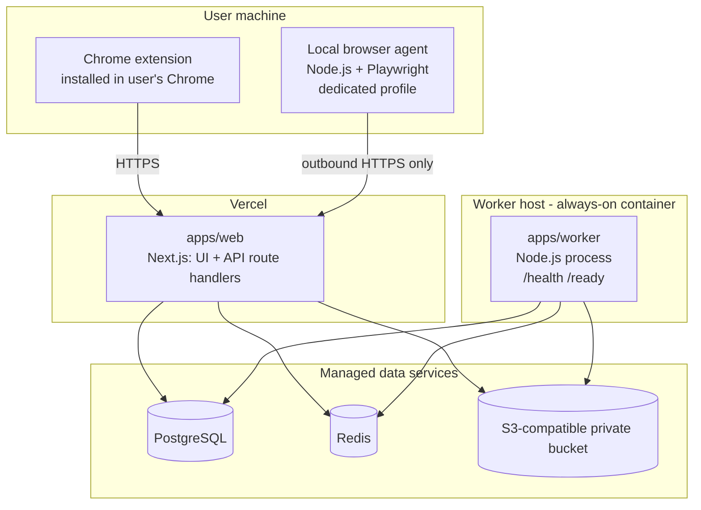

# Deployment

> Status: nothing is deployed. This document is the target layout. Phase 1 runs locally only.

## Deployment units

| Unit           | Where                                                                                                                                                        | Scales                              | Notes                                                                                                                                                                     |
| -------------- | ------------------------------------------------------------------------------------------------------------------------------------------------------------ | ----------------------------------- | ------------------------------------------------------------------------------------------------------------------------------------------------------------------------- |
| `apps/web`     | Vercel (project root directory `apps/web`)                                                                                                                   | Automatically                       | Stateless. Must not do long-running work. Enqueues tasks and returns.                                                                                                     |
| `apps/worker`  | An always-on container host that supports long-running processes, health checks and restarts on failure (for example Railway, Render, Fly.io, or a small VM) | 1 instance first, then horizontally | Needs `DATABASE_URL`, `REDIS_URL`, AI and storage keys. Health check path `/health`. Readiness uses `/ready`.                                                             |
| PostgreSQL     | Managed provider (for example Neon, Supabase, or a cloud provider's Postgres)                                                                                | Vertical                            | Use the **pooled** URL for the app and the **direct** URL for migrations. Daily backups and point-in-time recovery.                                                       |
| Redis          | Managed Redis with persistent connections and AOF persistence                                                                                                | Vertical                            | BullMQ keeps long-lived connections and polls. Prefer a plan priced per instance rather than per command, and check BullMQ compatibility (`maxmemory-policy noeviction`). |
| Object storage | S3-compatible private bucket (AWS S3, Cloudflare R2, ...)                                                                                                    | n/a                                 | Bucket is **private**. Access is through short-lived signed URLs after an ownership check. Server-side encryption on.                                                     |
| Extension      | Chrome Web Store (unlisted) or loaded unpacked for personal use                                                                                              | n/a                                 | Manifest V3. Minimal permissions and host permissions only for supported sites.                                                                                           |
| Local agent    | User's computer                                                                                                                                              | n/a                                 | Paired from the web app. Outbound HTTPS only. Profile directory stays local.                                                                                              |

The final choice of providers is deliberately left open. The code only depends on standard
`DATABASE_URL`, `REDIS_URL` and S3 variables, so switching providers is a configuration change.

## Cloud vs local: what lives where

| Data or capability                            | Cloud             | User machine                      |
| --------------------------------------------- | ----------------- | --------------------------------- |
| Account, settings, tasks, applications, audit | ✅ PostgreSQL     |                                   |
| CVs, generated documents, evidence            | ✅ private bucket |                                   |
| AI provider and service API keys              | ✅ secret stores  |                                   |
| Job-portal logins, cookies, browser sessions  | ❌ never          | ✅ user's browser / agent profile |
| Running automated browser workflows           | ❌                | ✅ local agent                    |
| Overnight scheduling and retries              | ✅ worker         |                                   |

Overnight browser steps only run if the user's local agent is online. Otherwise those tasks wait
in `RETRY_WAIT` and the morning report lists them. Nothing that needs the user's logged-in
session runs in the cloud.

## Environments

| Environment | Web                                | Worker                                | Data                                                                    |
| ----------- | ---------------------------------- | ------------------------------------- | ----------------------------------------------------------------------- |
| Local       | `pnpm --filter @job-agent/web dev` | `pnpm --filter @job-agent/worker dev` | Local Postgres and Redis (Docker or native), `STORAGE_DRIVER=local`     |
| Preview     | Vercel preview per branch          | Optional shared staging worker        | Separate staging database, Redis and bucket. **Never production data.** |
| Production  | Vercel production                  | Worker host, production service       | Production services                                                     |

## Build and release (planned)

- **Web:** Vercel runs `pnpm install` and then `pnpm turbo run build --filter=@job-agent/web`.
  Workspace packages are compiled by Next (`transpilePackages`).
- **Worker:** Phase 1 runs TypeScript directly with `tsx`. Before the first production deploy
  (Phase 12), the worker gets a bundled build (single JS file plus a Dockerfile) so production
  does not compile at runtime. This is decision D-013.
- **Migrations:** run once per release, from CI or a release step, with the direct database URL.
  Never on app start. Web and worker must tolerate the previous schema during rollout
  (expand, then contract).
- **CI (Phase 2):** `pnpm check`, then integration tests against disposable Postgres and Redis,
  then e2e.

## Secrets in deployment

- Vercel: project environment variables, separated for Production and Preview.
- Worker host: the host's secret store.
- Nothing secret is prefixed `NEXT_PUBLIC_`.
- Rotate on suspicion. All keys come from env, so rotation needs no code change.

## Operational checks

- Uptime monitor on `GET /api/health` (web) and `GET /health` (worker).
- Alert when the worker `/ready` is not 200 for more than 5 minutes (from Phase 3).
- Alert on repeated connector `down` status or AI budget exhaustion (from the observability phase).
