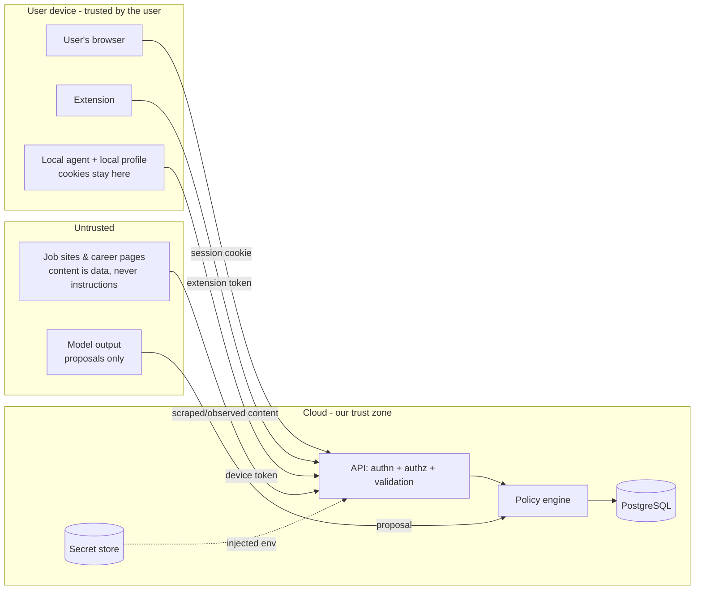

# Security and permissions

> Status: policy rules (`evaluateSubmissionPolicy`, `evaluateEmailSendPolicy`), ownership check,
> audit log, log redaction, **authentication (Better Auth, email + password) and per-user data
> isolation are implemented and tested** (Phase 2). Browser-agent and extension credentials arrive
> in Phase 9.

## Trust boundaries

| Boundary            | Rule                                                                                                                                                                                  |
| ------------------- | ------------------------------------------------------------------------------------------------------------------------------------------------------------------------------------- |
| Internet → API      | Every request is authenticated (except `/api/health`), validated with Zod, and rate limited.                                                                                          |
| API → data          | Every query is scoped by `user_id` from the auth context, never from the request body.                                                                                                |
| Model → actions     | The model proposes. The executor validates against the tool registry, the state machine and the policy engine.                                                                        |
| Web content → model | Job descriptions and page text are **untrusted data**. They are passed to the model as quoted content and can never change tools, permissions or settings (prompt-injection defence). |
| Cloud → local agent | Commands are short-lived, typed, tied to a task, and only for that user's registered agent. The agent re-validates them.                                                              |
| Local agent → cloud | Only structured observations. Never cookies, passwords or tokens.                                                                                                                     |

## Authentication

- **Web (implemented, Phase 2):** Better Auth 1.7 with email + password and database sessions
  (`apps/web/src/server/auth.ts`).
  - Passwords: 12–128 characters, hashed with scrypt. Only the hash is stored.
  - Sessions: httpOnly, SameSite cookie. 7-day expiry, refreshed daily, revocable by deleting
    the row. Session tokens are stored in plain form (decision D-017).
  - Verification identifiers are stored hashed.
  - Rate limiting is stored in Postgres, so it holds across serverless instances: sign-in 5 per
    minute, sign-up 5 per hour. Better Auth enables it in production only.
  - Sign-up is controlled by `AUTH_SIGNUP_ALLOWED_EMAILS`. With an empty list it is open in
    development and **closed in production**.
  - Email verification is **off** until an email provider exists (Phase 10, decision D-018).
  - CSRF: Better Auth checks the Origin header on its endpoints (`trustedOrigins = APP_URL`).
    Our own write routes refuse a mismatched `Origin` (`withAuth` → 403).
  - Every protected page and API route checks the session **on the server**. Layout checks are
    not relied on alone.
- **Local browser agent:** the user pairs it with a one-time code shown in the web app. The agent
  gets a device credential, and only a hash of it is stored server-side. The user can revoke it.
  Heartbeats are recorded in `browser_agent_heartbeats`.
- **Extension:** a separate, scoped, revocable token, never the web session cookie.
- **Future Flutter app:** the same API with bearer tokens. The contracts in `packages/shared`
  are client-neutral.

## Authorization and user isolation

1. Every private table has `user_id` (FK → `users.id`) and an index starting with `user_id`.
2. Repository and port methods take `userId` as their first argument. There is no unscoped
   `findById` (see `TaskStore`).
3. `assertOwnership(ctx, ownerId)` runs again on records loaded by id, as defence in depth.
4. Cross-user access returns "not found", so the response does not reveal whether a record
   exists.
5. Integration tests (`*.int.test.ts` in `packages/database` and `apps/web`) prove that user A
   cannot read, change or act on user B's records.
6. The user id always comes from the server-side session (`withAuth` → `AuthContext`), never
   from the URL or the request body. The settings API has no user-id parameter at all.

## Permission and approval policy

`packages/security/src/policy.ts` is server-side and deny-by-default. Rules for **submitting an
application** apply in order:

| #   | Condition                                                        | Effect             |
| --- | ---------------------------------------------------------------- | ------------------ |
| 1   | already submitted                                                | `deny` (duplicate) |
| 2   | required fields without a verified answer                        | `needs_review`     |
| 3   | uses unverified answers                                          | `needs_review`     |
| 4   | CAPTCHA / OTP / login / access blocker                           | `manual_handoff`   |
| 5   | daily limit reached (user's time zone)                           | `defer`            |
| 6   | source unhealthy                                                 | `defer`            |
| 7   | user mode `manual_only`                                          | `manual_handoff`   |
| 8   | source policy not reviewed                                       | `manual_handoff`   |
| 9   | source does not permit auto-submit                               | `manual_handoff`   |
| 10  | user mode `approve_each`, no valid approval                      | `require_approval` |
| 11  | otherwise (`approve_each` + approval, or `auto_where_permitted`) | `allow`            |

**Email:** always `require_approval` unless an approval exists for the **exact content hash**.
Editing a draft invalidates its approval.

**Approvals** are bound to a content hash and expire. Approving a cover letter does not approve
a different one generated later.

## Data integrity rules for candidate information

- The system **never invents** candidate facts (salary, notice period, visa status, years of
  experience, degree, and so on).
- Form values come only from **verified** answers (`profile_answers.verified_at` is set by an
  explicit user action) or verified profile fields.
- Unknown required fields become `unresolved_fields`, which leads to `NEEDS_REVIEW`.
- Generated text (cover letters, tailored CV wording) may rephrase but must not add facts that
  are not in the verified profile. The user sees and approves it before it is used.

## Automation rules

- No bypassing of CAPTCHA, OTP, account blocks, access controls or rate limits. These conditions
  are **terminal for automation**: the task goes to `MANUAL_HANDOFF`.
- No retrying of a submission with an uncertain outcome until verification resolves it.
- Self-recovery cannot change permissions, user settings or source declarations.
- The daily target (20) is a ceiling, not a quota. The agent never lowers its quality bar or
  source restrictions to meet it.

## Secret management

| Secret                                | Where it lives                                                       | Never                                                  |
| ------------------------------------- | -------------------------------------------------------------------- | ------------------------------------------------------ |
| DB, Redis, storage, AI and email keys | Hosting secret store → env vars. Locally: root `.env` (git-ignored). | In code, in logs, in the database, sent to the browser |
| Auth secret                           | Same                                                                 | Same                                                   |
| Local agent device credential         | User's machine (local config), hash on server                        | Committed, logged                                      |
| Job-portal passwords and cookies      | **Only** in the user's browser or local agent profile                | Sent to or stored in the cloud                         |

- `.env.example` contains names and empty placeholders only.
- `.gitignore` excludes `.env*`, keys, browser profiles, storage-state files, HAR files and
  `.data/`.
- Env validation errors name the variable and never print its value (tested in the worker).
- Future per-user API keys (bring-your-own-key) will be encrypted with a key held outside the
  database (envelope encryption).

## Logging sensitive actions

- `createJsonLogger` redacts secret-like keys (`password`, `apiKey`, `accessToken`, `cookie`,
  `otp` and similar) and masks bearer tokens and email addresses in strings. This is tested.
- Logs carry **ids, not content**. CV text, answers and email bodies are never logged.
- Security-relevant actions go to the append-only `audit_logs` table (`AuditAction` in
  `packages/security/src/audit.ts`) with identifiers and outcomes only.

## Web hardening (implemented)

`X-Content-Type-Options: nosniff`, `X-Frame-Options: DENY`, `Referrer-Policy`,
`Permissions-Policy`, `poweredByHeader: false`, and no search-engine indexing.
