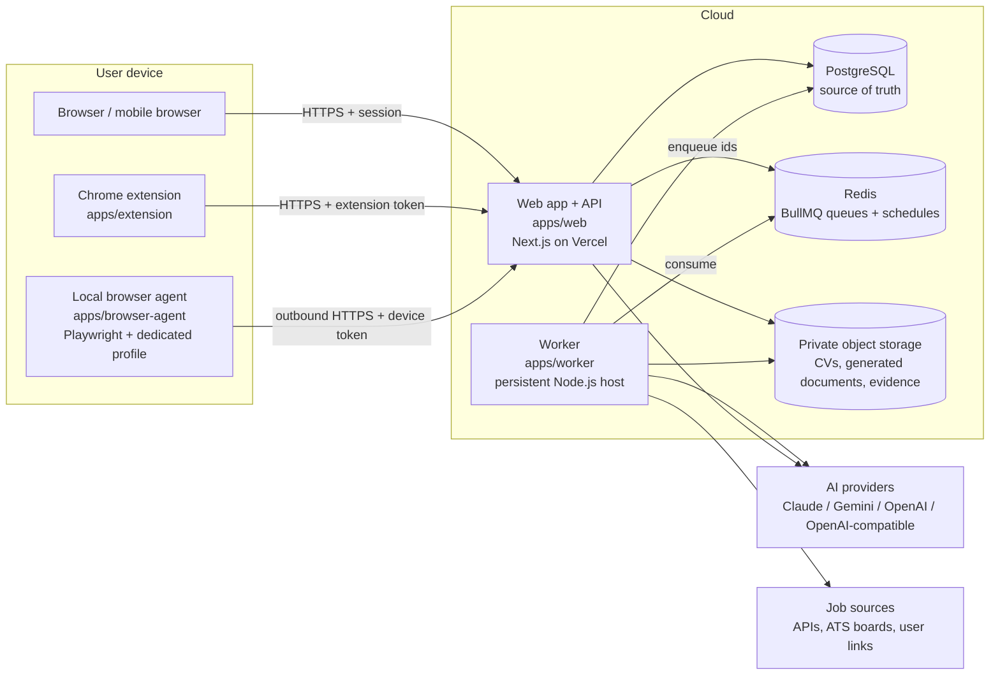
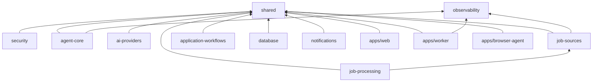

# System overview

> Status: Phase 1 (foundation). This document describes the target architecture. Items marked
> **(implemented)** exist in the repository today; everything else is designed but not built.

## What the system does

A personal agent that discovers relevant jobs in India and the Middle East, compares them with
the candidate's CV, prepares tailored applications, fills forms on supported sites, tracks every
application, and keeps working overnight on a persistent worker. The user controls it through one
chat interface and approves anything with external, irreversible effects.

## Components and where they run

| Runs in the cloud                                    | Runs on the user's machine                                                              |
| ---------------------------------------------------- | --------------------------------------------------------------------------------------- |
| `apps/web`: UI, chat, API route handlers (Vercel)    | Browser (any device) using the web app                                                  |
| `apps/worker`: queues, schedules, retries, reports   | `apps/extension`: assists on pages the user opens                                       |
| PostgreSQL, Redis, object storage (managed services) | `apps/browser-agent`: permitted automated browser workflows in a separate local profile |

Browser sessions, cookies and site logins **stay on the user's machine**. The cloud never holds
the user's job-portal passwords or cookies.

## Module boundaries

The 14 required modules map to workspace folders as follows.

| Module                  | Location                                                              | Responsibility                                                                                                         |
| ----------------------- | --------------------------------------------------------------------- | ---------------------------------------------------------------------------------------------------------------------- |
| `web`                   | `apps/web/src/app`, `apps/web/src/components`                         | UI, chat, dashboard, settings, approvals, tracker                                                                      |
| `api`                   | `apps/web/src/app/api/**`, `apps/web/src/server`                      | Authenticated route handlers, request validation **(health route implemented)**                                        |
| `agent-core`            | `packages/agent-core`                                                 | Orchestration contracts, task state machine, recovery rules, tool registry **(contracts + state machine implemented)** |
| `ai-providers`          | `packages/ai-providers`                                               | Provider adapters, capability checks, timeouts, fallback routing **(contracts)**                                       |
| `job-sources`           | `packages/job-sources`                                                | Connectors and capability/policy declarations **(contracts + deny-by-default registry)**                               |
| `job-processing`        | `packages/job-processing`                                             | Normalization, dedup, freshness, matching **(contracts)**                                                              |
| `application-workflows` | `packages/application-workflows`                                      | Preparation, form filling, verification, handoff **(contracts)**                                                       |
| `browser-agent`         | `apps/browser-agent`, `apps/extension`, protocol in `packages/shared` | Local agent, extension, command protocol **(protocol + interfaces)**                                                   |
| `background-workers`    | `apps/worker`                                                         | Durable jobs, schedules, retries, morning reports **(health server implemented)**                                      |
| `data`                  | `packages/database`                                                   | Schema, migrations, repositories **(primitives only; schema from Phase 2)**                                            |
| `security`              | `packages/security`                                                   | Auth context, ownership, policy engine, audit **(policy rules implemented)**                                           |
| `notifications`         | `packages/notifications`                                              | Approval requests, alerts, reports **(contracts)**                                                                     |
| `observability`         | `packages/observability`                                              | Structured logs with redaction, metrics **(logger implemented)**                                                       |
| `shared`                | `packages/shared`                                                     | Common types, Zod schemas, API and protocol contracts **(implemented)**                                                |

### Deviations from the suggested layout

- **No separate `packages/api`.** Route handlers must live inside the Next.js app. Request and
  response schemas live in `packages/shared` so a future Flutter app, the extension and the local
  agent use the same contracts.
- **The browser-agent protocol lives in `packages/shared`**, not in `apps/browser-agent`, because
  the server sends commands and the agent executes them. Both sides need the same schema.
- **No queue package yet.** The `TaskQueue` port is in `agent-core`. The BullMQ adapter will be
  shared by web (producer) and worker (consumer), so Phase 3 adds it as `packages/task-queue`.

### Dependency rules

1. `packages/*` never import from `apps/*` (enforced by ESLint).
2. `shared` imports no other workspace package (enforced by ESLint).
3. Domain packages define **ports** (interfaces such as `TaskStore` and `AuditLog`). `database`
   and the future `task-queue` package implement them. Domain logic never imports Prisma or
   BullMQ directly.
4. No vendor SDK (AI, email, storage) is imported outside its adapter package.

These rules keep the system as one deployable web app plus one worker today. Any package can
later move into its own service without rewriting its callers.

## Request lifecycles (target)

**Interactive chat request.** The user sends a message. The web API authenticates the user,
validates the message and creates an `agent_tasks` row. It enqueues the task id, and the worker
runs the agent loop (see [agent-execution-flow.md](agent-execution-flow.md)). The UI follows
progress through task events.

**Overnight run.** A per-user schedule in the worker fires in the user's time zone. It creates a
`daily_discovery` task, which spawns one `job_application` task per selected job. Policy and
daily limits apply to each one. A morning report summarizes the results.

**Browser step.** The worker issues a short-lived command to the user's registered local agent.
The agent executes it locally and returns a structured observation. Nothing happens if the agent
is offline. The task waits in `RETRY_WAIT` and is reported if the agent stays offline.

## Related documents

- [agent-execution-flow.md](agent-execution-flow.md)
- [application-state-machine.md](application-state-machine.md)
- [job-source-connectors.md](job-source-connectors.md)
- [security-and-permissions.md](security-and-permissions.md)
- [database-design.md](database-design.md)
- [background-processing.md](background-processing.md)
- [ai-provider-routing.md](ai-provider-routing.md)
- [deployment.md](deployment.md)
