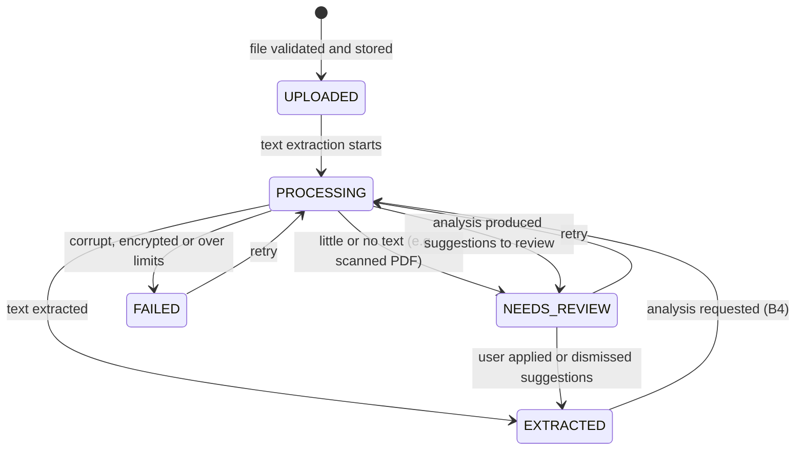

# Phase 2 brief — Database, CV Management & Candidate Profile

> **Status: APPROVED on 2026-10-18 (decisions in B12) and IMPLEMENTED as Phase 2B. Status per acceptance criterion: [implementation-roadmap.md](implementation-roadmap.md).**
>
> - **Part A** is your brief, copied word for word. It was cut off twice when pasted, both times
>   at the same point (the word "Provide" at the end of section 2B), so Part A stops there.
> - **Part B** is a **proposal** for everything after that point, written to match the existing
>   architecture. Every Part B item needs your approval. Section B12 lists the decisions I need
>   from you.
>
> **About the name:** the roadmap's "Phase 2" (accounts, settings, data layer) is already built,
> verified and signed off. This brief would run next, as **Phase 2B**. It pulls the roadmap's CV
> and profile work (old Phase 5) ahead of the durable task engine (Phase 3). See B12, decision 1.

---

## Part A — Your brief (verbatim)

Phase 2 — Database, CV Management & Candidate Profile
Act as a Senior Full-Stack Engineer and Database Architect working on my Personal AI Job Application Agent.
Phase 1 was intended to establish the repository structure, architecture documentation, shared contracts, and development configuration.
Your task now is to implement Phase 2 only: persistent database, candidate profile management, CV upload and analysis pipeline, and reusable verified application answers.
Do not implement job discovery, browser automation, automatic applications, or the complete AI agent in this phase.

### 1. Start by inspecting the repository

Before making changes:

1. Inspect the existing directory structure, package manager, workspace configuration, architecture documents, environment variables, and existing code.
2. Read the Phase 1 database design and security documentation.
3. Identify which components are implemented, incomplete, or only documented.
4. Run the existing tests and type checks to establish a baseline.
5. Reuse existing conventions and dependencies wherever possible.
6. Do not recreate the project, delete existing files, or overwrite working functionality.
7. If Phase 1 was not completed, implement only the minimum prerequisites required for this phase and document the deviations.

Do not assume that a database, authentication system, storage provider, or migration framework is already configured.

### 2. Database setup

Use PostgreSQL and the ORM/migration system established in Phase 1. If Prisma was selected, use Prisma migrations and the existing Prisma schema.
Implement the minimum database entities required for this phase.

#### A. Users and candidate profiles

users

- id
- email
- timezone
- created_at
- updated_at

Reuse the project's existing authentication user model if one exists. Do not create a second, disconnected identity system.

candidate_profiles

- id
- user_id
- full_name
- preferred_name
- email
- phone
- current_location
- preferred_locations
- professional_summary
- total_experience_months
- current_role
- education
- skills
- certifications
- languages
- work_authorization
- notice_period
- expected_salary
- salary_currency
- employment_preferences
- created_at
- updated_at

Use appropriate PostgreSQL types, including JSONB where flexible structured data is justified. Validate structured fields instead of accepting arbitrary unvalidated JSON.
Do not infer or invent candidate facts from an incomplete CV. Keep unknown fields null or explicitly marked as unknown.

#### B. Resume management

Create a `resumes` table with:

- id
- user_id
- original_filename
- storage_key
- mime_type
- file_size_bytes
- checksum
- version
- extraction_status
- extracted_text or a reference to securely stored extracted content
- parsed_profile_json
- extraction_error
- is_primary
- created_at
- updated_at

Requirements:

- Support PDF and DOCX initially.
- Validate file type, file size and file contents.
- Generate a unique storage key; never trust the uploaded filename as a storage path.
- Store files in private object storage, not in a public web directory.
- Store extracted text and parsed profile data securely.
- Keep original CV versions so users can see which version was used.
- Prevent duplicate uploads where appropriate using checksums.
- Track extraction states such as `UPLOADED`, `PROCESSING`, `EXTRACTED`, `NEEDS_REVIEW`, and `FAILED`.
- Provide _[the brief is cut off here]_

---

## Part B — Proposed completion (needs your approval)

### B0. What already exists and is reused (from the step 1 inspection)

| Brief asks for                              | Already in the repository                                                                                         | Plan                                                                                                                                      |
| ------------------------------------------- | ----------------------------------------------------------------------------------------------------------------- | ----------------------------------------------------------------------------------------------------------------------------------------- |
| PostgreSQL + Prisma migrations              | Prisma 7.10, migration `20261018120000_init`, Docker Postgres 17                                                  | Add one new migration. No reset, no rewrite.                                                                                              |
| `users` (id, email, timezone, timestamps)   | Better Auth `users` table (id, email, timestamps). Time zone lives in `user_settings.time_zone` (decision D-020). | Reuse it; no second identity system. Keep the time zone in `user_settings` (B12, decision 2).                                             |
| `candidate_profiles`                        | Minimal table (`headline`, `summary`) with a repository                                                           | **Extend** it to the full field list. `summary` becomes `professional_summary`. Nothing needs migrating: no real profile data exists yet. |
| Auth, user isolation, audit, API foundation | `withAuth`, Zod parsing, error envelope, append-only `audit_logs`, integration-test setup                         | Reuse all of it.                                                                                                                          |
| Private storage                             | Only `.env` placeholders (`STORAGE_DRIVER`, `S3_*`)                                                               | New `packages/storage`.                                                                                                                   |
| AI provider layer                           | Interfaces only (`packages/ai-providers`)                                                                         | See B4 and B12, decision 3.                                                                                                               |

Baseline before any change: `pnpm check` passes, along with 27 integration tests and 5 e2e tests. CI is green.

### B1. Resume management — rest of 2B ("Provide …")

Proposed wording for the missing bullets:

- Provide a **version history** per user: every upload is a new immutable version (`version` = 1, 2, 3 … per user). Files are never overwritten. A later phase records which version each application used.
- Provide **exactly one primary resume** per user, enforced by a partial unique index `unique(user_id) where is_primary`. The first successful upload becomes primary automatically, and the user can change it.
- Provide **secure download** of the original file to its owner only. The response streams through an authenticated route with `Content-Disposition: attachment`; there is never a public URL.
- Provide **deletion** by the owner. Deletion removes both the stored file and the row, and is audited. Phase 2B blocks deleting the only remaining resume while it is primary; later phases will block deleting a version an application used.
- Provide **re-processing**: a resume in `FAILED` or `NEEDS_REVIEW` can be processed again.

**Duplicates:** `checksum` = SHA-256 of the file bytes, with `unique(user_id, checksum)`. Uploading identical bytes again returns `409 CONFLICT` with the existing resume's id. No second copy is stored.

**Status flow:**

Extra columns proposed beyond the brief's list: `analyzed_at`, `reviewed_at`, `page_count`, `text_char_count`, and `analysis_model` (provider/model used, if any).

### B2. Reusable verified application answers (section C, proposed)

New table `profile_answers`. The name and the "verified only" rule come from the existing database design.

| Column                        | Notes                                                                                                                                                                                                                        |
| ----------------------------- | ---------------------------------------------------------------------------------------------------------------------------------------------------------------------------------------------------------------------------- |
| `id`, `user_id`, timestamps   | Standard. `user_id` FK with cascade.                                                                                                                                                                                         |
| `question_key`                | Canonical key from a fixed catalog, e.g. `notice_period_days`, `expected_salary`, `willing_to_relocate`, `work_authorization_<country>`, `years_experience`, `linkedin_url`. Free-form custom questions use `custom:<slug>`. |
| `question_text`               | How the question is usually worded, shown to the user.                                                                                                                                                                       |
| `answer_type`                 | `text`, `long_text`, `number`, `boolean`, `single_select`, `multi_select`, `date`, `money`, `url`.                                                                                                                           |
| `answer_value`                | JSONB, validated by a Zod schema chosen by `answer_type`. Arbitrary JSON is never accepted.                                                                                                                                  |
| `source`                      | `USER_ENTERED`, `PROFILE_FIELD`, or `CV_SUGGESTION_CONFIRMED`.                                                                                                                                                               |
| `status`                      | `DRAFT`, `VERIFIED`, or `ARCHIVED`. **Only `VERIFIED` answers may ever be used to fill forms.**                                                                                                                              |
| `verified_at`, `last_used_at` | Editing the value of a verified answer sets it back to `DRAFT` until the user verifies it again.                                                                                                                             |
| `is_sensitive`                | Salary, visa status and similar answers are highlighted in the UI and excluded from logs.                                                                                                                                    |

Constraint: `unique(user_id, question_key) where status <> 'ARCHIVED'`.

**Not stored as reusable answers:** protected characteristics such as gender, ethnicity, religion, disability, age or marital status. Forms that ask these are always left for the user to answer by hand. This is a deliberate privacy choice; you can override it (B12, decision 6).

### B3. Candidate profile fields (types and validation)

| Field                                                | Type                                                                                                                      | Validation (Zod, shared by API and UI)                                              |
| ---------------------------------------------------- | ------------------------------------------------------------------------------------------------------------------------- | ----------------------------------------------------------------------------------- |
| `full_name`, `preferred_name`, `current_role`        | text                                                                                                                      | trimmed, 1–200 characters, or null                                                  |
| `email` (contact email, may differ from login email) | text                                                                                                                      | email format, or null                                                               |
| `phone`                                              | text                                                                                                                      | E.164-style `+<country><number>`, or null                                           |
| `current_location`                                   | JSONB `{ city, countryCode }`                                                                                             | ISO-2 country code                                                                  |
| `preferred_locations`                                | JSONB array of `{ city?, countryCode, remoteOk? }`                                                                        | max 20                                                                              |
| `professional_summary`                               | text                                                                                                                      | max 3,000 characters                                                                |
| `total_experience_months`                            | integer                                                                                                                   | 0–720, or null (unknown)                                                            |
| `education`                                          | JSONB array of `{ institution, degree?, fieldOfStudy?, startDate?, endDate?, grade? }`                                    | dates as `YYYY-MM`; max 20                                                          |
| `skills`                                             | JSONB array of `{ name, level?: beginner\|intermediate\|advanced\|expert, years? }`                                       | unique names; max 100                                                               |
| `certifications`                                     | JSONB array of `{ name, issuer?, issuedOn?, expiresOn?, credentialId? }`                                                  | max 50                                                                              |
| `languages`                                          | JSONB array of `{ language, proficiency: native\|fluent\|professional\|basic }`                                           | max 20                                                                              |
| `work_authorization`                                 | JSONB array of `{ countryCode, status: citizen\|permanent_resident\|work_visa\|needs_sponsorship\|unknown, validUntil? }` | one entry per country                                                               |
| `notice_period`                                      | JSONB `{ days: int\|null, negotiable: bool\|null }`                                                                       | days 0–365                                                                          |
| `expected_salary`                                    | numeric(12,2)                                                                                                             | ≥ 0, or null                                                                        |
| `salary_currency`                                    | char(3)                                                                                                                   | ISO 4217 (INR, AED, SAR, QAR, KWD, BHD, OMR, USD, …); required when a salary is set |
| `employment_preferences`                             | JSONB `{ employmentTypes[], workplaceTypes[], willingToRelocate?, earliestStartDate? }`                                   | values from fixed enums                                                             |
| **Proposed addition:** `work_experience`             | JSONB array of `{ company, title, startDate, endDate?, current, location?, summary? }`                                    | max 50                                                                              |

`work_experience` isn't in your list, but job matching (a later phase) needs it, and every CV contains it. See B12, decision 5.

**Unknown means null.** Every field is nullable, and the UI shows "Not provided". Nothing is ever filled in by inference.

### B4. CV analysis pipeline

**Step 1 — Text extraction (always on, no AI).**

- PDF: `unpdf` 1.9 (maintained, reads text only and executes no PDF scripts). DOCX: `mammoth` 1.13 (raw text).
- Limits: maximum 10 MB per file, maximum 30 pages, and maximum 200,000 extracted characters. DOCX files are capped at 50 MB uncompressed, as zip-bomb protection.
- If a file has fewer than about 200 characters of text, it is probably a scanned image. It goes to `NEEDS_REVIEW` with the message "No selectable text; OCR is not supported yet".
- Deterministic extraction of obvious contact data (email, phone, LinkedIn URL) using patterns. These are returned as **suggestions**, not written to the profile.

**Step 2 — Structured analysis (AI-assisted; see B12, decision 3).**

- One call per CV through the existing `ModelProvider` interface, with a minimal Anthropic adapter. This is a single structured-extraction call, not the agent.
- The model must return JSON that matches the profile schema, and **every suggested value must include a short verbatim quote (`evidence`) from the CV**.
- Server-side anti-invention check: a suggestion is **dropped** if its evidence quote is not literally found in the extracted text, or if its value isn't supported by that quote. Missing information stays null; there is no guessing.
- The CV text is passed as untrusted, quoted content, so instructions hidden inside a CV are ignored (prompt-injection defence). The output is validated with Zod.
- Cost control: requires `AI_MONTHLY_BUDGET_USD` and an API key. If either is missing, analysis is disabled, and the user fills in the profile by hand from the extracted text.
- Analysis can be re-run, and records which model produced it.

**Step 3 — Human review (always).**

- Suggestions are shown **field by field, next to the current profile value and its evidence quote**. The user accepts or rejects each one.
- **Nothing reaches `candidate_profiles` or `profile_answers` without an explicit user action.** Each accepted field is audited (`profile.updated`, with field names and resume id, never values).

**Where it runs:** the durable job queue is roadmap Phase 3 and doesn't exist yet. So text extraction runs inside the upload request; it's bounded by the limits above and finishes in seconds. Analysis runs as an explicit `POST /api/resumes/:id/analyze` request with a 60-second timeout. Both become worker jobs in Phase 3. This is a documented, temporary deviation.

### B5. Private object storage

- New package `packages/storage` with an `ObjectStorage` interface: `put`, `get` (stream), `delete`, `exists`.
- **Local driver** (development): files go under `STORAGE_LOCAL_DIR` (`.data/storage`, which is git-ignored and outside the web app). Keys are resolved strictly inside that root, so path traversal is impossible.
- Storage keys are generated as `users/<userId>/resumes/<uuid>`. The original filename is never part of a path; it is stored only for display, after sanitising.
- **Encryption at rest (proposed):** AES-256-GCM using `DATA_ENCRYPTION_KEY` from the environment, applied to file bytes, extracted text and the parsed profile JSON. Even a leaked database dump or storage folder then shows no CV content. See B12, decision 4.
- **S3 driver:** see B12, decision 7. Vercel has no persistent disk, so production needs S3 or R2 before deployment.

### B6. API routes (all use `withAuth`; another user's ids return 404)

| Method and path                                                                       | Purpose                                                                                   |
| ------------------------------------------------------------------------------------- | ----------------------------------------------------------------------------------------- |
| `GET /api/profile` · `PATCH /api/profile`                                             | Read or update the profile (partial; strict Zod schema)                                   |
| `POST /api/resumes`                                                                   | Upload (`multipart/form-data`, one file) → validate → store → extract text                |
| `GET /api/resumes` · `GET /api/resumes/:id`                                           | Version list and detail (status, errors, metadata; extracted-text preview on detail only) |
| `GET /api/resumes/:id/file`                                                           | Download the original (owner only, `attachment`, `no-store`)                              |
| `POST /api/resumes/:id/primary`                                                       | Make this version primary                                                                 |
| `POST /api/resumes/:id/reprocess`                                                     | Retry extraction                                                                          |
| `POST /api/resumes/:id/analyze`                                                       | Run AI analysis (B4, step 2)                                                              |
| `GET /api/resumes/:id/suggestions` · `POST /api/resumes/:id/suggestions/apply`        | Review, then accept selected suggestions (profile fields and answers)                     |
| `DELETE /api/resumes/:id`                                                             | Delete a version (rules in B1)                                                            |
| `GET /api/answers` · `POST /api/answers`                                              | List or create answers; the catalog is in `@job-agent/shared`                             |
| `PATCH /api/answers/:id` · `POST /api/answers/:id/verify` · `DELETE /api/answers/:id` | Edit (resets to `DRAFT`), verify, archive                                                 |

All request and response schemas live in `@job-agent/shared`, so a future mobile app can reuse them.

### B7. UI (under `/app`, mobile-friendly)

- **Profile** (`/app/profile`): sectioned form (contact, summary, experience, education, skills, certifications, languages, work authorization, notice period and salary, preferences). Empty fields show "Not provided".
- **Resumes** (`/app/resumes`): upload with drag-and-drop, version list with status badges and primary marker, download, delete, retry, analyze. A **review screen** shows each suggestion with its evidence quote, accept/reject per field, and "accept all with evidence".
- **Answers** (`/app/answers`): catalog-driven list showing draft or verified state, editors chosen by answer type, a verify button, and a sensitive marker.
- **Navigation:** Dashboard · Profile · Resumes · Answers · Settings.

### B8. Validation rules (summary)

- **Files:** the allowed list is PDF and DOCX, detected from the **file's first bytes** (`%PDF-`, or a ZIP containing `word/document.xml`). The browser's MIME type and the file extension are ignored for the decision. Macro-enabled `.docm` files, encrypted PDFs and files that are empty or over the limits are rejected with clear messages.
- **Data:** every JSONB column has a Zod schema, used both server-side on write and in the UI. The database adds CHECK constraints for ranges (experience months, salary ≥ 0, currency length).
- **Errors:** `VALIDATION_FAILED` lists field paths and messages and never echoes the uploaded content.

### B9. Security

- Ownership on every row (`user_id`), repository methods scoped by `userId`, and cross-user ids return 404.
- The upload size is enforced **while reading** the stream, not after buffering it. There is a per-user upload limit (for example 30 per day).
- No CV content, answer values or salaries in logs or audit metadata: ids and field names only. Existing redaction stays on.
- Downloads use `Content-Disposition: attachment`, `X-Content-Type-Options: nosniff`, and `Cache-Control: no-store`.
- AI calls send only the extracted text needed. Keys stay server-side, the budget cap applies, and CV text is treated as untrusted input.
- Account deletion cascades to resumes, answers and stored files. File deletion is handled by the storage layer.

### B10. Tests

- **Unit:**
  - file sniffing, using synthetic PDF and DOCX fixtures generated in the tests; no real CVs;
  - rejection cases (fake extension, `.docm`, oversized file, zip bomb, encrypted PDF);
  - checksum and duplicate detection;
  - every Zod schema;
  - the evidence-verification filter (an invented value without real evidence is dropped);
  - encryption round-trip;
  - local-driver path-traversal attempts.
- **Integration (real Postgres):**
  - profile, resume and answer isolation between two users;
  - the upload → extract flow;
  - a duplicate upload returning 409;
  - the single-primary constraint;
  - verify and edit-resets-verification;
  - audit rows without values;
  - analysis through a **fake** model provider; no live AI calls in tests or CI.
- **E2E:** upload a synthetic CV → text extracted → edit profile → create and verify an answer.

### B11. Acceptance criteria

1. One new Prisma migration applies cleanly to the existing database. The existing data and all current tests remain green.
2. A user can upload a PDF or DOCX. Invalid, oversized, renamed or macro-enabled files are rejected, with clear errors.
3. Files live only in private storage under generated keys. Nothing is reachable without the owner's session. With encryption approved, files and text are unreadable on disk.
4. Re-uploading identical bytes is detected via checksum. Versions are kept, and exactly one version is primary.
5. Extraction moves through `UPLOADED → PROCESSING → EXTRACTED`, `NEEDS_REVIEW` or `FAILED`, with a reason, and can be retried.
6. With analysis enabled, every suggestion carries a verbatim quote from the CV, and suggestions without one are discarded. **Nothing is written to the profile or answers without the user's acceptance.**
7. The profile can be viewed and edited. All structured fields are validated, and unknown values stay null.
8. Answers can be created, verified, edited (which un-verifies them) and archived. Only verified answers are marked usable.
9. Isolation is proven by integration tests for profile, resumes and answers.
10. `pnpm check`, build, integration and e2e tests pass locally and in CI. The docs are updated (database design, security, decisions, roadmap, README).

### B12. Decisions (approved 2026-10-18)

**Outcome:** 1 yes (Phase 2B now) · 2 keep the time zone in `user_settings` · **3 (b): text extraction only; no AI
in this phase** · 4 encryption on · 5 add `work_experience` · 6 exclude protected characteristics ·
7 S3 driver in the deployment phase.

**What decision 3 (b) changes in this brief:** B4 step 2 (AI analysis), the `analyze` endpoint, the
Anthropic adapter and the `analysis_model`/`analyzed_at` columns are **dropped** from Phase 2B.
Suggestions come only from deterministic pattern matching (email, phone in international `+`
format, LinkedIn URL). Each suggestion carries the exact matched text as evidence, and the user
still accepts or rejects it in B4 step 3. `NEEDS_REVIEW` is used when a file has no usable text
(for example a scanned PDF). The AI analysis moves to Phase 4 (AI provider layer).

Original options as proposed:

| #   | Decision                                                                                                                                                           | My recommendation                                                                                                                                                 |
| --- | ------------------------------------------------------------------------------------------------------------------------------------------------------------------ | ----------------------------------------------------------------------------------------------------------------------------------------------------------------- |
| 1   | Run this as **Phase 2B now**, before the task engine (Phase 3)?                                                                                                    | Yes: profile data is useful early, and nothing here depends on Phase 3.                                                                                           |
| 2   | Keep the time zone in `user_settings` (D-020) instead of adding `users.timezone`?                                                                                  | Keep it; it's the same data, so two copies would drift apart.                                                                                                     |
| 3   | CV analysis: **(a)** AI-assisted with a minimal Anthropic adapter (needs your API key and a budget), **(b)** text extraction only now, with AI analysis in Phase 4 | (a), if you have an Anthropic API key with billing. Otherwise (b): the pipeline still extracts text and contact suggestions, and you fill in the profile by hand. |
| 4   | App-level AES-256-GCM encryption for CV files, extracted text and parsed JSON (`DATA_ENCRYPTION_KEY`)?                                                             | Yes. Losing the key makes the data unreadable, so the key must be backed up.                                                                                      |
| 5   | Add `work_experience` to the profile?                                                                                                                              | Yes                                                                                                                                                               |
| 6   | Exclude protected characteristics (gender, ethnicity, religion, disability, age, marital status) from reusable answers?                                            | Yes                                                                                                                                                               |
| 7   | S3/R2 storage driver: now (tested against a MinIO container) or in the deployment phase?                                                                           | Deployment phase: local storage is enough until then, and it keeps this phase smaller.                                                                            |
