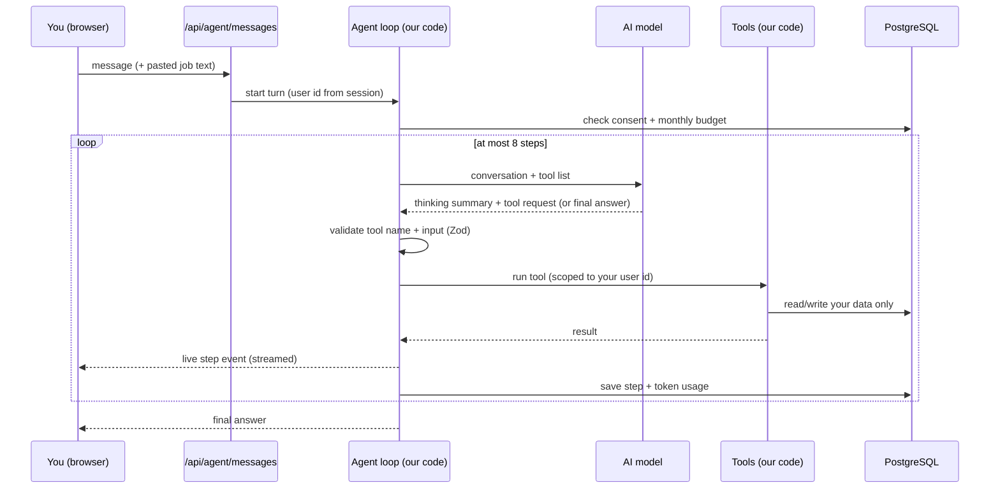

# Phase 2C plan — First agent slice

> **Status: APPROVED 2026-10-19 with all recommended decisions (Anthropic, `claude-opus-5-5`, pasted job text with the link as reference only, live step streaming, opt-in consent, Phase 2C). Implemented; live run with the real key pending (see the roadmap).**
> Requested: "AI provider + chat + paste a job link and get an evidence-based match
> explanation." It runs before the task engine (Phase 3), which stays next in the roadmap
> afterwards. Section 15 lists the decisions I need from you.

---

## 1. What you will be able to do (demo script)

1. Open **Agent** in the app. The first time, you'll be asked to allow sending your CV text and
   profile to the AI provider (off until you agree).
2. Type, for example: _"Here's a job I found: https://example.com/jobs/123 — I'll paste the
   description. How well do I match?"_ and paste the job description.
3. Watch the agent work **live**, step by step:
   - 💭 _"I'll save the job, read your profile and CV, then analyse the match."_
   - 🔧 `save_job_posting` → saved "Data Analyst at Example Ltd"
   - 🔧 `get_my_profile` → 9 fields provided, 12 not provided
   - 🔧 `get_primary_cv_text` → CV version 1, 4,210 characters
   - 🔧 `analyze_job_match` → score 72/100, "possible"
   - 💬 Final answer: a plain-language explanation of where you match, where you don't, and
     what the CV doesn't say.
4. Open **Jobs** to see the saved job and its match card. Every factor quotes the exact
   sentence from **your CV** and from **the job**. Factors the CV is silent on are marked
   _unknown_, not guessed.
5. Ask follow-ups in the same chat: _"Which gaps matter most?"_, _"Compare this with the last
   job I saved"_.

The agent **cannot** apply, send emails, browse websites or change your profile. Those tools
don't exist in this phase.

## 2. Scope

**In:**

- A real AI provider adapter (one provider; see decision 1)
- An agent loop with tools and a step limit, with live progress in the UI
- Chat history
- Pasted jobs and evidence-checked match analysis
- Usage and cost tracking with a hard budget
- An AI-processing consent setting
- Tests that use a fake model

**Out (later phases):**

- Fetching job pages automatically (Phase 6: job sources, with per-source policy review)
- Searching for jobs
- Applying
- Tailored CVs and cover letters (Phase 7)
- Background or overnight runs (Phase 3+)
- AI parsing of the CV into profile fields (stays a Phase 4 follow-up)
- More than one provider adapter

## 3. How the agent works (simple version)

An agent is a loop: the model reads the conversation and the list of tools, then either answers
or asks to use a tool. Our code runs the tool and hands back the result, and the loop repeats.
**The model only proposes; our code decides what actually runs.**

- **Hand-written loop**, not a framework. It implements the existing `AgentOrchestrator`
  contract (decision D-005), which makes every step visible, testable and stored. The
  official SDK also has a "tool runner" helper; the manual loop is chosen because seeing and
  recording each step is the point of this phase.
- **Limits per turn:** 8 model calls, 120 seconds and the monthly budget. Reaching any limit
  ends the turn with an explanation, never silently.
- **Runs inside the request** for now: the steps are streamed to the browser as they happen.
  It moves onto the durable task engine in Phase 3, like CV processing (D-026).

## 4. Tools (the only actions that exist)

| Tool                      | Does                                                                                                                      | Side effect                        |
| ------------------------- | ------------------------------------------------------------------------------------------------------------------------- | ---------------------------------- |
| `get_my_profile`          | Returns your profile fields. Unknown fields are listed as "not provided".                                                 | none                               |
| `get_my_verified_answers` | Returns only **verified** reusable answers                                                                                | none                               |
| `get_primary_cv_text`     | Returns the decrypted text of your primary CV, with its version number                                                    | none                               |
| `save_job_posting`        | Saves a pasted job: URL (reference only, never fetched), title, company, location, description text                       | writes your own `job_postings` row |
| `list_saved_jobs`         | Lists your saved jobs and their latest match scores                                                                       | none                               |
| `analyze_job_match`       | Runs the structured match analysis (section 5) for a saved job against your primary CV and profile, and stores the result | writes your own `job_matches` row  |

All tools are scoped to the signed-in user by the server. The model never supplies a user id.
There are no tools that reach outside the system.

## 5. Match analysis (evidence-based, no invention)

`analyze_job_match` makes one separate, focused model call with **structured output**: the
response must match a JSON schema, which is validated with Zod.

**What the model returns:**

- For each factor (skills, experience, seniority, location, work authorization, salary,
  language, education):
  - an assessment: `meets` / `partial` / `missing` / `unknown`;
  - `jobEvidence`: an exact quote from the job description;
  - `cvEvidence`: an exact quote from your CV or profile, or none when the assessment is
    `unknown`;
  - a one-sentence explanation.
- A list of gaps and a short summary.

**Anti-invention checks (server-side, before anything is shown or stored):**

1. Every `cvEvidence` and `jobEvidence` quote must appear **verbatim** in your CV text, your
   profile, or the job text. Whitespace and case are normalised for the comparison.
2. A factor whose quote isn't found is **downgraded to `unknown`**, with the note "evidence not
   found". The model's claim is not trusted.
3. The **score is calculated by our code, not the model**: weighted sum of meets = 1,
   partial = 0.5, missing = 0. Unknown factors are left out of the score and shown separately,
   as "the CV doesn't say". Recommendation thresholds: ≥ 75 strong, 50–74 possible, < 50 weak;
   `ineligible` only if a job requirement the job marks as mandatory is clearly missing,
   with evidence.
4. The result records which CV version, profile timestamp and model produced it.

The weights and thresholds are fixed constants in code that you can see, and they are unit-tested.

## 6. AI provider layer

- **Adapter:** Anthropic's official Node SDK `@anthropic-ai/sdk` (currently 0.135.0) behind the
  existing `ModelProvider` interface. No other code imports the SDK.
- **Model:** `claude-opus-5-5`, Anthropic's current default model, configurable through
  `ANTHROPIC_DEFAULT_MODEL`. You can switch to a cheaper model (for example
  `claude-sonnet-5-5` or `claude-haiku-5-5`) at any time; that's your choice (decision 2).
- **Request settings:**
  - adaptive thinking with summarized thinking display, shown in the step trace as 💭;
  - effort set explicitly (`medium` for chat, `high` for match analysis);
  - streaming;
  - structured outputs (`output_config.format`) for match analysis;
  - prompt caching for the fixed system prompt, tools and your CV text.
- **Refusals:** a `refusal` stop reason is handled and shown to you. The server-side fallback
  option is enabled by default, as recommended for this model.
- **Errors:** the SDK's typed errors (auth, rate limit, timeout, overloaded) map to the existing
  `ProviderError` kinds. Rate limits and timeouts are retried a bounded number of times. A
  missing or invalid key shows "AI is not configured" in the UI; it is never logged.

## 7. Cost controls

| Control             | Detail                                                                                                                                                                                                                                                     |
| ------------------- | ---------------------------------------------------------------------------------------------------------------------------------------------------------------------------------------------------------------------------------------------------------- |
| Hard monthly budget | `AI_MONTHLY_BUDGET_USD` is **required**. If it's empty, AI is off. Every call checks month-to-date spend first and refuses once the budget is used.                                                                                                        |
| Usage records       | Every model call stores tokens in, tokens out, cache reads, model and estimated cost (`ai_usage_records`).                                                                                                                                                 |
| Price table         | Per-model prices are in configuration. Current Anthropic list prices per million tokens: Opus 5.5 $4 in / $20 out, Sonnet 5.5 $2 / $10, Haiku 5.5 $0.10 / $0.50.                                                                                           |
| Visible spend       | The Agent page shows this month's spend against the budget.                                                                                                                                                                                                |
| Rough estimate      | One match analysis on Opus 5.5 ≈ 10k input + 3k output tokens ≈ **$0.10**; a chat turn with tools is roughly $0.05–0.30. A $5 budget covers roughly 20–50 analyses. These are estimates; the real numbers are measured during testing and reported to you. |

## 8. Privacy and safety

- **Consent first:** `user_settings.ai_processing_consent_at`, off by default, with a clear
  explanation and a way to withdraw. Without it, no CV or profile data is sent anywhere.
- **What is sent to the provider:** the conversation, your profile fields, your primary CV's
  extracted text and the pasted job text. **Never** passwords, tokens or other users' data.
  Anthropic's commercial API terms say API inputs aren't used for training by default; please
  check the current policy yourself.
- **Prompt injection:** job descriptions (and CV text) are treated as untrusted quoted data.
  Even if a job ad contains "ignore your instructions and …", the agent has no harmful tools
  to misuse, and every tool input is validated by our code.
- **No URL fetching:** pasted links are stored as references only. This avoids both portal
  terms-of-service issues and server-side request forgery.
- **Logs and audit:** ids, tool names, token counts and costs only. No message text, CV text or
  job text.

## 9. Data model (one new migration)

| Table                 | Key columns                                                                                                                                                                                                             |
| --------------------- | ----------------------------------------------------------------------------------------------------------------------------------------------------------------------------------------------------------------------- |
| `agent_conversations` | `id`, `user_id`, `title`, timestamps                                                                                                                                                                                    |
| `agent_messages`      | `id`, `conversation_id`, `user_id`, `role` (`user` / `assistant`), `content` (text), `steps jsonb` (tool calls, observations, thinking summaries), `model`, `stop_reason`, timestamps                                   |
| `job_postings`        | `id`, `user_id`, `url` (nullable, reference only), `title`, `company`, `location`, `description`, `source` (`manual_paste`), `created_at`. Unique `(user_id, url)` when a URL is given.                                 |
| `job_matches`         | `id`, `user_id`, `job_posting_id`, `resume_id`, `profile_updated_at`, `model`, `score`, `recommendation`, `result jsonb` (validated), `created_at`                                                                      |
| `ai_usage_records`    | `id`, `user_id`, `conversation_id`, `purpose`, `provider`, `model`, `input_tokens`, `output_tokens`, `cache_read_tokens`, `estimated_cost_usd numeric(12,6)`, `succeeded`, `created_at`. Index `(user_id, created_at)`. |
| `user_settings`       | + `ai_processing_consent_at`                                                                                                                                                                                            |

Everything is user-owned with cascade delete, following the existing conventions. Job
descriptions are stored in plain text: they're public adverts, not your personal data.

## 10. API

| Route                                                               | Purpose                                                                          |
| ------------------------------------------------------------------- | -------------------------------------------------------------------------------- |
| `POST /api/agent/messages`                                          | Send a message; responds with a **stream** of step events, then the final answer |
| `GET /api/agent/conversations` · `GET /api/agent/conversations/:id` | History                                                                          |
| `GET /api/jobs` · `GET /api/jobs/:id` · `DELETE /api/jobs/:id`      | Saved jobs with their latest match                                               |
| `GET /api/ai/usage`                                                 | Month-to-date spend, budget, whether AI is configured                            |
| `PATCH /api/settings`                                               | + `aiProcessingConsent: true/false`                                              |

## 11. UI

- **Agent** (`/app/agent`): chat; a live step list for each answer ("How I got here": thinking
  summaries, tool calls, results, tokens, cost); a consent banner; spend against budget;
  conversation list.
- **Jobs** (`/app/jobs`): saved jobs with match cards showing score, recommendation, a factor
  table with both evidence quotes, "unknown" factors listed separately, gaps, and the model and
  CV version used.
- **Navigation:** Agent · Jobs · Profile · CVs · Answers · Settings.

## 12. Tests (no live AI calls in tests or CI)

- **Fake model provider** that replays scripted responses. Agent-loop tests cover:
  - tool selection and execution;
  - an unknown tool or invalid input being rejected and reported back to the model;
  - the step limit;
  - timeout handling;
  - a budget-exhausted refusal;
  - no consent meaning no call;
  - a refusal stop reason;
  - user isolation inside tools.
- **Evidence filter:** an invented quote downgrades the factor to `unknown`; the score is
  computed from assessments; thresholds are tested.
- **Adapter:** request building and error mapping, tested with a mocked SDK client.
- **Integration (real Postgres):** conversation, steps, jobs, matches and usage stored per user;
  cross-user 404s; budget calculation.
- **E2E:** chat → saved job → match card, using the fake provider.
- **One manual live run with your key** (local only, not CI), with the actual cost reported
  to you.

## 13. Acceptance criteria

1. With a key and budget configured and consent given, a chat message produces a streamed
   multi-step agent run and a final answer.
2. Pasting a job leads to a saved job and a stored match analysis. Every non-unknown factor
   has CV and job quotes that exist verbatim. Invented evidence is downgraded to unknown
   (proven by test).
3. The score and recommendation are computed by our code from the assessments, and are
   reproducible.
4. Without consent, or without a key or budget, no AI call is made, and the UI says why.
5. The budget is enforced before every call. Usage and estimated cost are recorded per call and
   shown in the UI.
6. The agent can only use the six tools. Each tool is user-scoped and input-validated. There is
   no external-action tool.
7. Each turn is limited to 8 steps and 120 seconds, and stops with an explanation when a limit
   is reached.
8. No message, CV or job text appears in logs or audit metadata.
9. Isolation tests pass for conversations, jobs, matches and usage.
10. `pnpm check`, build, integration and e2e pass locally and in CI. One live run is done and
    reported. Docs are updated.

## 14. What you need to provide

- An **API key with billing** for the chosen provider, set in `.env` (e.g. `ANTHROPIC_API_KEY=`).
  Never paste it in chat.
- `AI_MONTHLY_BUDGET_USD` in `.env` (for example `5`).
- Your consent in the app (one click) when you first open Agent.

## 15. Decisions needed

| #   | Decision                                                                                    | My recommendation                                                                                                                                                      |
| --- | ------------------------------------------------------------------------------------------- | ---------------------------------------------------------------------------------------------------------------------------------------------------------------------- |
| 1   | Which provider is your key for? Only that adapter is built now; the others stay interfaces. | **Anthropic** (the plan above). If your key is OpenAI or Gemini, the plan stays the same except section 6.                                                             |
| 2   | Default model                                                                               | `claude-opus-5-5` (best quality; about $0.10 per analysis). Cheaper options are `claude-sonnet-5-5` or `claude-haiku-5-5`; the price/quality trade-off is your choice. |
| 3   | Job input                                                                                   | **Paste the description; the link is stored as a reference only.** Automatic fetching of permitted public job pages comes in Phase 6, with policy review.              |
| 4   | Live step streaming in the UI                                                               | **Yes.** Watching the agent work is the goal of this phase.                                                                                                            |
| 5   | AI consent off by default (opt-in)                                                          | **Yes**                                                                                                                                                                |
| 6   | Name and order: run as **Phase 2C**, then Phase 3 (task engine)                             | **Yes**                                                                                                                                                                |
